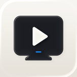
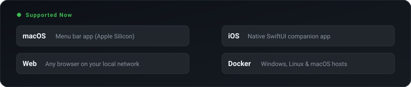

<div align="center">



# Mello TV

### Your own streaming stack. Self-hosted on your Mac or with Docker, watched anywhere.

[](https://github.com/ChrisRodStar/Mello-Tv/releases)
[](https://github.com/ChrisRodStar/Mello-Tv/stargazers)
[](#platforms)
[](https://buymeacoffee.com/chrissinclair)

</div>

---

I built Mello TV because free movie sites suck. You click play and spend ten minutes fighting off fake download buttons, sketchy popups, and random redirects just to watch an episode of something in bed.

Mello TV runs on your Mac or in Docker. It finds the sources, strips out the garbage ads and trackers, and streams clean video straight to your iPhone or browser. Leave the server running, then open the iPhone app or web player on your home network.

> **Privacy heads-up:** Run a VPN on the computer hosting Mello TV. This is meant for your own personal home network (or through Tailscale on the go). Keep your connection private and safe.

---

### Platforms

<p align="center">
  
</p>

---

### Quick Start

#### Mac app

1. **Install the Mac host** — Grab the DMG from [Releases](https://github.com/ChrisRodStar/Mello-Tv/releases) and drag **Mello TV** into your Applications folder.
2. **Create a profile** — Open the web player or iOS app. Catalog access is included; no TMDB account or key setup is needed.
3. **Start watching** — Head to `http://localhost:8080` in your browser, or sideload the iOS IPA onto your iPhone. If you're on the same Wi-Fi, it finds the server immediately.

#### Docker — Windows, Linux, or macOS

Install and start Docker. From a copy of this repository, use this
`compose.yaml`. Catalog access is included:

```yaml
services:
  mello:
    image: mello-tv:local
    build: .
    ports:
      - "8080:8080"
    volumes:
      - mello-data:/data
    restart: unless-stopped
    init: true
    read_only: true
    tmpfs:
      - /tmp:rw,noexec,nosuid,size=64m,mode=1777
    logging:
      driver: local
      options:
        max-size: "10m"
        max-file: "3"
    stop_grace_period: 30s
    security_opt:
      - no-new-privileges:true
    cap_drop:
      - ALL

volumes:
  mello-data:
```

```sh
docker compose up -d --build --wait
```

Open **http://localhost:8080**, or `http://SERVER-IP:8080` from another device.
The first run builds the image locally. Your profiles, history, and catalog
stay in the `mello-data` volume across container updates. You can optionally
supply a personal key through `TMDB_API_KEY` or `TMDB_READ_ACCESS_TOKEN` in
the Compose service’s `environment` block.

See [Docker management and verification](docs/DOCKER.md) for updates, storage,
and networking details.

---

<div align="center">

### Support Mello TV

If you're using this and want to help support the project, drop a star on the repo or buy me a coffee!

<br/>

[](https://buymeacoffee.com/chrissinclair)

<sub>For personal home use. Metadata and posters provided by <a href="https://www.themoviedb.org">TMDB</a>.</sub>

</div>
