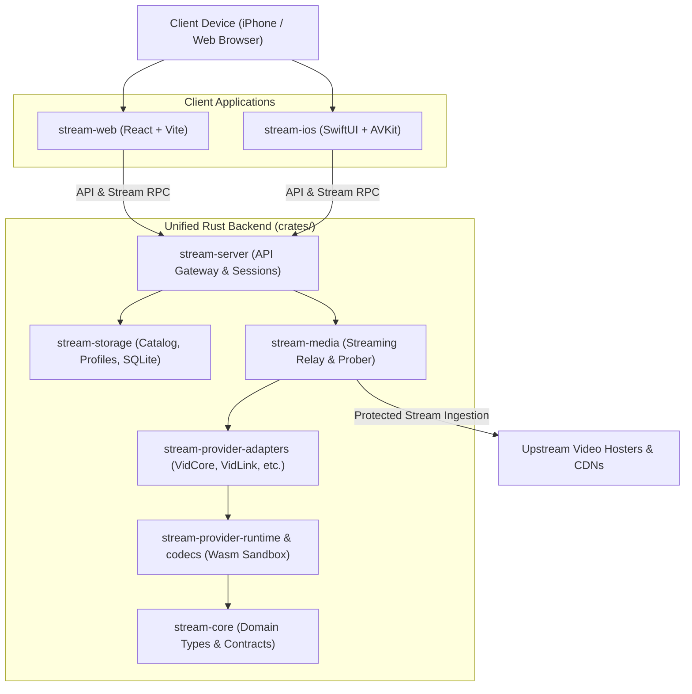
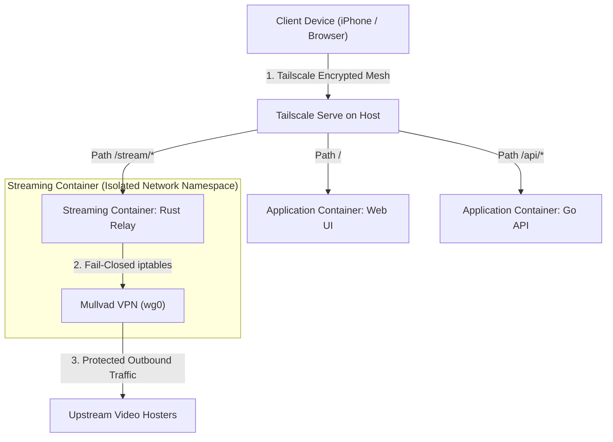
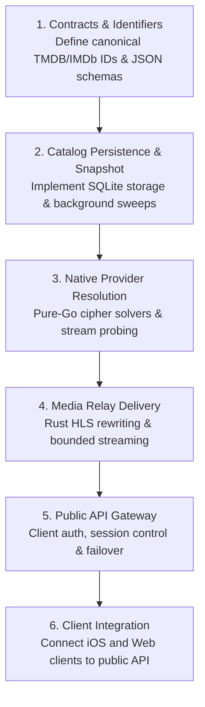

# Stream TV

**A private, resilient, fail-closed household media architecture.**

[Architecture](#system-architecture) &bull; [Projects](#the-project-fleet) &bull; [Privacy & Security](#privacy-and-fail-closed-routing) &bull; [Data Resilience](#data-and-resilience) &bull; [Development](#development-and-implementation-order)

---

## Overview

The backend has been completely migrated to a unified, high-performance, portable **Rust workspace** (`crates/`), replacing the legacy multi-service Go and standalone relay implementations with a single memory-safe binary suite:

- **100% Native Codecs & Ciphers**: Zero headless browsers, zero node runtimes. Provider ciphers (VidCore, VidLink, VidSrc, VidFast, Videasy) run directly in Rust WebAssembly and native crypto crates.
- **Sub-Second to Low-Latency Stream Resolution**: Integrated DNS caching, HTTP/2 connection pooling, parallel playlist promotion, and in-memory protocol compilation.
- **Fail-Closed Privacy & Relay**: Streaming proxy with HLS rewriting, bounded backpressure buffers, and robust token authorization.
- **Clients**: Native iOS (SwiftUI) and modern Web (React + Vite) frontends.

---

## System Architecture

The repository is organized into a modular Rust workspace and client applications:

---

## The Project Fleet

| Directory | Stack | Responsibility |
|---|---|---|
| [crates/](crates) | Rust 2024 Workspace | **The Unified Backend:** High-performance server, catalog database, media streaming relay, and reverse-engineered provider cipher engine. |
| [deploy/](deploy) | Docker Compose | **The Orchestrator:** Container and service deployment configurations. |
| [ios/](ios) | SwiftUI + AVKit | **The iOS Client:** Native mobile interface with speculative background player pre-warming. |
| [web/](web) | React + Vite | **The Web Client:** Clean browser interface featuring keyboard navigation, tap-to-seek gestures, and continue-watching shelves. |

---

## Privacy and Fail-Closed Routing

Stream TV enforces absolute network isolation so that client devices never communicate directly with upstream video hosts.

1. **Private Ingress:** Tailscale Serve acts as the single entry point. Remote devices connect over a private, authenticated mesh tunnel.
2. **Fail-Closed VPN Egress:** All provider scraping and media fetching in the streaming container must route through the Mullvad WireGuard interface (`wg0`). If the tunnel disconnects, outbound traffic drops immediately via kernel firewall rules to prevent IP exposure.
3. **Manifest Link Sanitization:** The Rust relay parses all `.m3u8` playlists and rewrites external segment URLs into local relay paths (`/stream/{session_id}/r/{resource_id}?st={token}`). Client devices never receive direct addresses to third-party CDNs.

---

## Data and Resilience

The system is designed to survive upstream outages without breaking the home viewing experience:

- **Offline-First Metadata:** The catalog service continuously pulls updates from TMDB, but the API maintains a cached read snapshot. If TMDB has an outage, family members can still browse shelves and watch saved titles.
- **Direct Artwork Delivery:** Browsers and apps load poster and backdrop images directly from TMDB's edge CDN. The local database stores lightweight URL references only, avoiding server disk consumption.
- **Self-Contained Resolution:** Playback requests include canonical TMDB IDs along with IMDb/MyAnimeList cross-IDs and TV coordinates. Providers resolve media without waiting on a synchronous catalog lookup.
- **Ordered Fallback Streams:** When an episode begins, the API pre-stages ranked backup sources. If an upstream hoster stutters or drops, the player can trigger an instant failover.

---

## Development and Implementation Order

Development and validation follow a strict dependency order:

### Working Conventions

- All active development can run locally. Production deployment targets Docker Compose with optional Tailscale Serve routing.
- Secrets, WireGuard private keys, and local SQLite databases must never be committed to source control.
