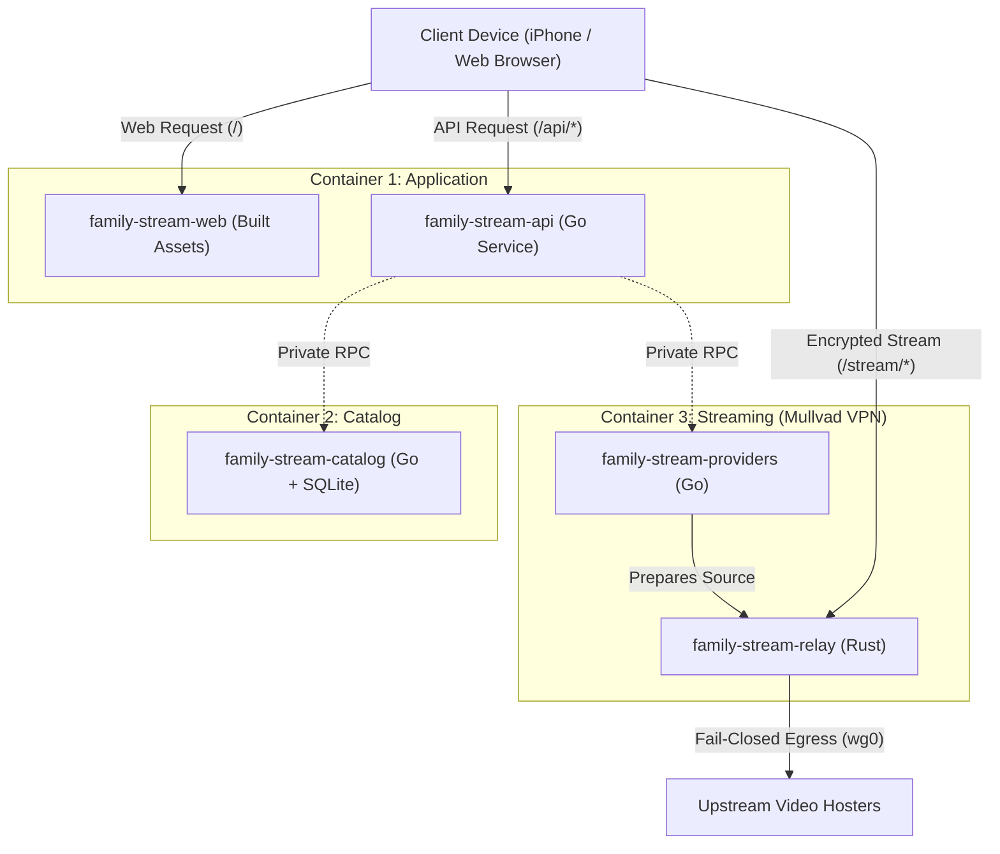
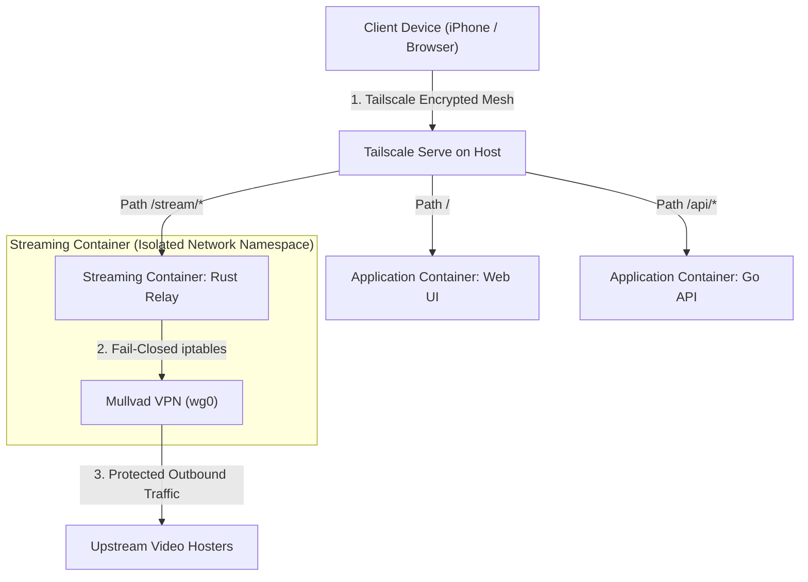
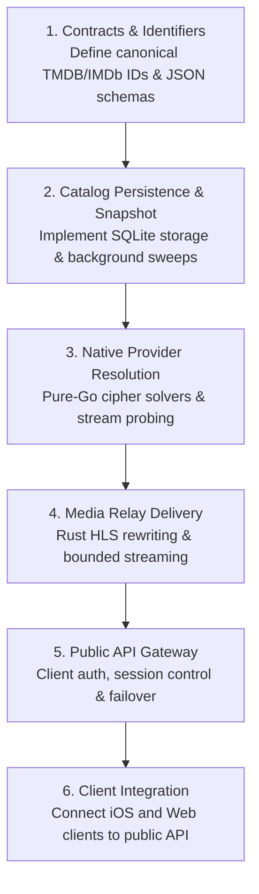

# Stream TV

**A private, resilient, fail-closed household media architecture.**

[Architecture](#system-architecture) &bull; [Projects](#the-project-fleet) &bull; [Privacy & Security](#privacy-and-fail-closed-routing) &bull; [Data Resilience](#data-and-resilience) &bull; [Development](#development-and-implementation-order)

---

## Overview

Think of **Stream TV** like building your very own private Netflix from scratch.

Commercial streaming services often drop licenses, and public streaming sites are cluttered with pop-up ads, sketchy tracking scripts, and dead links. Stream TV replaces that chaos with a dedicated home server that does all the work behind the scenes:

- Locates video sources across multiple providers.
- Decodes and solves provider security challenges natively in pure code (no heavy headless browsers).
- Streams video segments through an isolated, fail-closed VPN tunnel.
- Serves clean, uninterrupted 1080p video directly to your iPhone, iPad, or browser.

---

## System Architecture

The workspace is organized into **six separately maintained projects** deployed across **three application containers**:

---

## Core Architecture Rules

> [!IMPORTANT]
> **Repository Boundary:** This root directory is an orchestrator, not a monolithic application. Each project maintains its own dependencies, releases, and contracts.

> [!IMPORTANT]
> **Three-Container Topology:** The production stack consists of exactly three containers (`application`, `catalog`, and `streaming`). Services inside the streaming container are supervised independently so provider updates do not restart the media relay or VPN.

---

## The Project Fleet

| Project | Stack | Responsibility |
|---|---|---|
| [api/](api) | Go | **The Gatekeeper:** Handles accounts, profiles, personal watch history, bookmark shelves, and issues Ed25519-signed digital playback passes (JWTs). |
| [catalog/](catalog) | Go + SQLite | **The Librarian:** Manages persistent title metadata, seasons, episodes, and recommendations. Syncs with TMDB in the background. |
| [deploy/](deploy) | Docker Compose | **The Orchestrator:** Multi-container production deployment for Application, Catalog, and Streaming containers. |
| [providers/](providers) | Go | **The Detective:** Reverse-engineers provider ciphers (VidCore, VidLink, VidSrc, VidFast) in native Go. Probes candidate streams for 1080p resolution and codecs. |
| [relay/](relay) | Rust + Tokio | **The Privacy Shield:** Validates playback tokens, fetches media through VPN, sanitizes HLS manifests, and relays video with bounded backpressure. |
| [ios/](ios) | SwiftUI + AVKit | **The iOS Client:** Native mobile interface with speculative background player pre-warming (starting playback in as little as 115ms). |
| [web/](web) | React + Vite | **The Web Client:** Clean browser interface featuring keyboard navigation, tap-to-seek gestures, and continue-watching shelves. |

---

## Privacy and Fail-Closed Routing

Stream TV enforces absolute network isolation so that client devices never communicate directly with upstream video hosts.

1. **Private Ingress:** Tailscale Serve acts as the single entry point. Remote devices connect over a private, authenticated mesh tunnel.
2. **Fail-Closed VPN Egress:** All provider scraping and media fetching in the streaming container must route through the Mullvad WireGuard interface (`wg0`). If the tunnel disconnects, outbound traffic drops immediately via kernel firewall rules to prevent IP exposure.
3. **Manifest Link Sanitization:** The Rust relay parses all `.m3u8` playlists and rewrites external segment URLs into local relay paths (`/stream/{session_id}/r/{resource_id}?st={token}`). Client devices never receive direct addresses to third-party CDNs.

---

## Data and Resilience

The system is designed to survive upstream outages without breaking the home viewing experience:

- **Offline-First Metadata:** The catalog service continuously pulls updates from TMDB, but the API maintains a cached read snapshot. If TMDB has an outage, family members can still browse shelves and watch saved titles.
- **Direct Artwork Delivery:** Browsers and apps load poster and backdrop images directly from TMDB's edge CDN. The local database stores lightweight URL references only, avoiding server disk consumption.
- **Self-Contained Resolution:** Playback requests include canonical TMDB IDs along with IMDb/MyAnimeList cross-IDs and TV coordinates. Providers resolve media without waiting on a synchronous catalog lookup.
- **Ordered Fallback Streams:** When an episode begins, the API pre-stages ranked backup sources. If an upstream hoster stutters or drops, the player can trigger an instant failover.

---

## Development and Implementation Order

Development and validation follow a strict dependency order:

### Working Conventions

- All active development can run locally. Production deployment targets Docker Compose with optional Tailscale Serve routing.
- Secrets, WireGuard private keys, and local SQLite databases must never be committed to source control.
