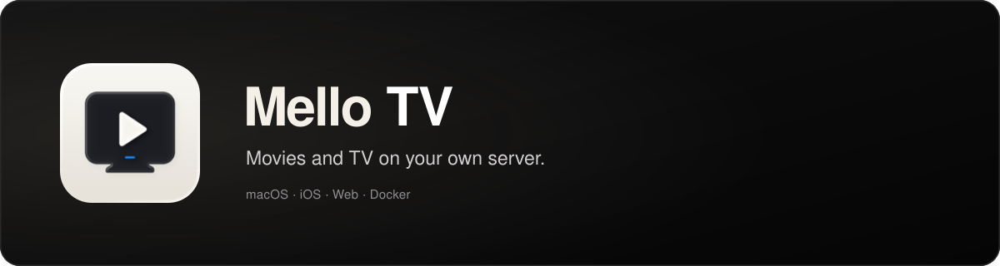

<p align="center">
  
</p>

<div align="center">

[](https://github.com/ChrisRodStar/Mello-Tv/releases)
[](https://github.com/ChrisRodStar/Mello-Tv/stargazers)
[](#get-started)
[](https://buymeacoffee.com/chrissinclair)

</div>

### Why I Built Melo TV

I built Mello TV because free movie sites suck. You sit down to watch one episode before bed. Ten minutes later, you've closed six tabs, dodged three fake download buttons, and somehow won an iPhone you never asked for. The episode still hasn't started. I wanted to watch a show, not fight the website. So I built Mello TV. It finds the videos and plays them right in the app. Run it on your Mac or with Docker, open it on your iPhone or in your browser, and pick something to watch.

<div align="center">

## Get started

</div>

### Mac

1. Download the Mac app from [Releases](https://github.com/ChrisRodStar/Mello-Tv/releases).
2. Drag **Mello TV** into your Applications folder and open it.
3. Open **http://localhost:8080** and create a profile.

### iPhone

Download the iPhone app from [Releases](https://github.com/ChrisRodStar/Mello-Tv/releases) and sideload it onto your phone. Open it while connected to the same Wi-Fi as your server.

### Docker

Install and start Docker, then download or clone this repository. Use this `compose.yaml` in the project folder:

```yaml
services:
  mello:
    image: mello-tv:local
    build: .
    ports:
      - "8080:8080"
    volumes:
      - mello-data:/data
    restart: unless-stopped
    init: true
    read_only: true
    tmpfs:
      - /tmp:rw,noexec,nosuid,size=64m,mode=1777
    logging:
      driver: local
      options:
        max-size: "10m"
        max-file: "3"
    stop_grace_period: 30s
    security_opt:
      - no-new-privileges:true
    cap_drop:
      - ALL

volumes:
  mello-data:
```

Start Mello TV:

```sh
docker compose up -d --build --wait
```

Open **http://localhost:8080**. On another device, use `http://SERVER-IP:8080`.

Your profiles, watch history, and saved titles stay in the `mello-data` volume when you update the container.

[More Docker options →](docs/DOCKER.md)

> Run a VPN on the computer hosting Mello TV. Use your home network, or Tailscale when you're away.

---

<div align="center">

### Support Mello TV

If you're using this and want to help support the project, drop a star on the repo or buy me a coffee!

<br/>

[](https://buymeacoffee.com/chrissinclair)

<sub>For personal home use. Metadata and posters provided by <a href="https://www.themoviedb.org">TMDB</a>.</sub>

</div>
