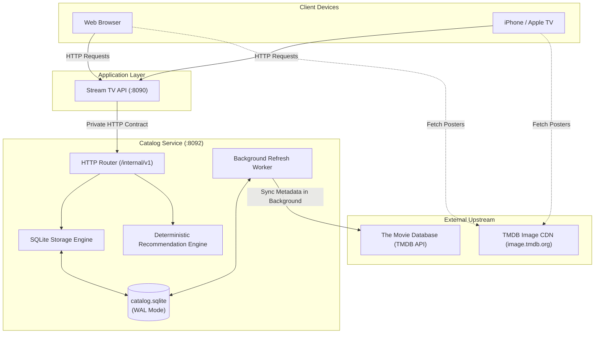

<div align="center">

# Stream TV Catalog Service

**Persistent title metadata, offline SQLite storage, and background TMDB synchronization.**

[Overview](#overview) &bull; [Core Principles](#core-principles) &bull; [How It Works](#how-it-works) &bull; [Architecture Diagram](#architecture-diagram) &bull; [Quick Start](#quick-start) &bull; [Documentation](#documentation)

---

</div>

## Overview

Think of the **Catalog Service** as the master card catalog and reference library for Stream TV.

When you open a streaming app like Netflix or Apple TV, you expect to instantly see movie posters, plot descriptions, episode lists, release dates, and personalized recommendations. You do not want the app to freeze while it dials an external website on the internet to find out what year *Inception* came out.

The Catalog Service makes sure Stream TV never freezes:
- It maintains its own local **SQLite database** containing complete movie and TV show information.
- It refreshes information from **The Movie Database (TMDB)** in the background.
- It calculates smart, personalized **recommendations** using transparent mathematical formulas—without expensive or unpredictable AI services.
- It operates **offline-first**: if TMDB goes down, or your home internet temporarily drops, your family can still browse all existing titles, shelves, and watch history smoothly.

> [!IMPORTANT]
> The Catalog Service is a private internal backend. It communicates strictly with the Stream TV API over an isolated network port (`8092`). It never accepts direct traffic from the public internet.

---

## Core Principles

1. **TMDB is an Updater, Not a Runtime Dependency:**
   When a user clicks on a movie, the Catalog answers immediately from local storage. It never blocks a user while waiting for an external network request.
2. **Fail-Closed Resilience:**
   If TMDB is offline, rate-limited, or returns corrupted data, the Catalog retains the last known good information. Bad data from the internet never overwrites good data on disk.
3. **Strict Separation of Concerns:**
   The Catalog only cares about media metadata. It does not know who users are, what passwords they use, or how video files are streamed. User accounts live in the API service; video streaming lives in the Relay service.
4. **Zero-Cost, Deterministic Recommendations:**
   Instead of paying thousands of dollars for cloud AI tokens or waiting seconds for a chatbot to suggest a movie, the Catalog uses a deterministic scoring algorithm that ranks titles in milliseconds.

---

## How It Works

### 1. Title & Episode Metadata
The Catalog stores two types of title records:
- **Summaries:** Lightweight records used for browsing grids, containing title name, poster link, year, and genre.
- **Hydrated Details:** Full records containing cast, runtime, overview, episode titles, air dates, and IMDB cross-IDs.

### 2. The Background Worker
A dedicated background worker monitors which titles need updating:
- Fresh titles are kept for **24 hours**.
- General browsing shelves are refreshed every **6 hours**.
- If TMDB rate-limits the server (HTTP 429) or returns an error, the worker backs off for **30 minutes** before trying again.

### 3. Local-Only Image References
To keep storage fast and lightweight:
- The Catalog stores TMDB image URLs (posters and backdrops).
- User devices (iPhones, web browsers) download and cache the images directly from TMDB's global CDN (`image.tmdb.org`).
- The Raspberry Pi never wastes storage downloading or resizing image files.

---

## Architecture Diagram

The Catalog sits safely behind the Stream TV API, isolating database queries from external client devices:



---

## Subsystem Architecture

The codebase is organized into six focused, single-responsibility packages inside `internal/`:

```text
catalog/
├── cmd/
│   └── catalog/      # Main entrypoint, CLI flags, graceful shutdown, and VACUUM backup
└── internal/
    ├── model/        # Pure domain models (Identity, Title, Season, Episode)
    ├── db/           # SQLite datastore, WAL mode, memory mapping, and expression search index
    ├── upstream/     # TMDB HTTP client with connection pooling, streaming JSON, and jitter
    ├── recommend/    # Deterministic scoring, half-life decay, 70/30 serendipity, and contextual shelves
    ├── service/      # Background sync orchestrator, worker pool, and 15-minute sweeps
    └── api/          # Private REST gateway with Server-Timing telemetry and constant-time auth
```

---

## Verified Performance Highlights

Tested and verified on Apple M4 (Darwin arm64):

| Operation | Latency | Throughput | Resource Efficiency |
| :--- | :--- | :--- | :--- |
| **Title Search** (1,000 records) | **162.80 µs** | 6,142 ops/sec | 4.4x faster via SQLite expression index |
| **Recommendation Ranking** (100 candidates) | **9.83 µs** | 101,729 ops/sec | Pre-allocated memory pool (29 KB) |
| **Serendipity Blending** (70/30 rule) | **8.07 µs** | 123,915 ops/sec | Instant discovery mix with anti-clustering |
| **Direct Media Key Formatting** | **18.53 ns** | 53,966,540 ops/sec | Zero reflection overhead |
| **Direct SQLite Point Lookup** | **7.15 µs** | 139,860 ops/sec | Zero-copy kernel memory mapping |
| **End-to-End API Title Request** | **23.81 µs** | 41,993 req/sec | Includes active `Server-Timing` headers |

Full benchmark data and comparative analysis available in [results/2026-10-19-catalog-optimized/report.md](results/2026-10-19-catalog-optimized/report.md).

---

### Prerequisites
- Go 1.25 or newer installed on your system.

### Running Locally
Run the service directly from the `catalog/` directory:

```bash
# Compile the Go catalog binary
go build -o .local/catalog ./cmd/catalog

# Run the catalog with default local storage
./.local/catalog
```

By default, the service:
- Listens on `127.0.0.1:8092`.
- Stores metadata in `data/catalog.sqlite`.
- Operates in offline-only mode if no `TMDB_READ_ACCESS_TOKEN` is supplied.

### Verifying Service Health
In another terminal, check that the service is running and ready:

```bash
# Check process liveness
curl http://127.0.0.1:8092/internal/v1/health/live

# Check storage readiness
curl http://127.0.0.1:8092/internal/v1/health/ready
```

---

## Documentation

Comprehensive operational and architectural specifications:

- [docs/API.md](docs/API.md): Complete private HTTP API contract (`/internal/v1`), endpoints, and JSON schemas.
- [docs/DATABASE.md](docs/DATABASE.md): SQLite database schema, WAL mode, transactional migrations, and backup procedures.
- [docs/RECOMMENDATIONS.md](docs/RECOMMENDATIONS.md): The math-based recommendation scoring system, candidate filtering, and decay rules.
- [docs/OPERATIONS.md](docs/OPERATIONS.md): Environment variables, worker limits, rate limiting, and recovery runbooks.
