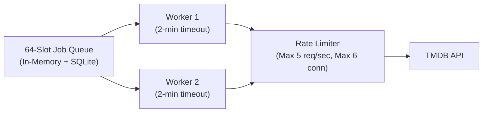

<div align="center">

# Catalog Operations & Maintenance

**Configuration parameters, background worker concurrency, healthchecks, and troubleshooting.**

[Overview](#overview) &bull; [Configuration Reference](#configuration-reference) &bull; [Worker Architecture](#worker-architecture) &bull; [Health & Monitoring](#health-and-monitoring) &bull; [Troubleshooting Runbook](#troubleshooting-runbook)

---

</div>

## Overview

The Stream TV Catalog Service is designed to be **autonomous and low-maintenance**.

Once deployed on the server, it runs quietly in the background:
- It automatically manages database connections and WAL checkpoints.
- It respects TMDB's rate limits with built-in request smoothers.
- It gracefully recovers from power loss or internet outages without manual intervention.

---

## Configuration Reference

The service is configured entirely through environment variables. It does not read local `.env` files directly, preventing accidental secret leakage.

| Environment Variable | Default Value | Plain English Description |
| :--- | :--- | :--- |
| `CATALOG_LISTEN` | `127.0.0.1:8092` | The private network address and port where the service listens. |
| `CATALOG_DB_PATH` | `data/catalog.sqlite` | The file path where the SQLite database is stored. |
| `CATALOG_PRIVATE_TOKEN` | *(None)* | Secret token required in HTTP Authorization headers for non-local requests. |
| `TMDB_READ_ACCESS_TOKEN` | *(None)* | The Movie Database (TMDB) API bearer token used for background syncing. |
| `CATALOG_MAX_DATA_BYTES` | `134217728` (128 MB) | Maximum logical size of stored JSON metadata payloads. |

> [!TIP]
> If `TMDB_READ_ACCESS_TOKEN` is omitted, the service starts in **offline-only mode**. It will continue serving all cached titles, seasons, and recommendations without making any outbound requests to the internet.

---

## Worker Architecture

Background syncing is managed by an internal queue and worker pool designed to avoid overwhelming your home internet connection:



### Worker Guardrails
1. **Concurrency Cap:** Exactly **2 background workers** process jobs in parallel.
2. **Execution Timeout:** Each individual sync job has a strict **2-minute deadline**. If an upstream request hangs, it is automatically terminated.
3. **Outbound Rate Limiting:** Outbound requests to TMDB are smoothed to a maximum of **5 starts per second** with no more than **6 concurrent connections**.
4. **Connection Keep-Alive Pooling:** Configured with an internal `http.Transport` pooling up to 20 idle TCP connections (10 per host) with a 90-second idle timeout, eliminating repetitive TLS handshakes.
5. **Streaming JSON Reader:** Metadata payloads stream directly into domain structs via `json.NewDecoder` rather than buffering multi-megabyte payloads in memory.
6. **Failure Cooldowns with Jitter:**
   - If TMDB returns HTTP `429 Too Many Requests`, the worker pauses for the duration specified in the `Retry-After` header (or 30 minutes default) plus up to 5 seconds of randomized jitter to prevent thundering herds.
   - If TMDB returns HTTP `5xx Server Error`, the worker enters a 30-minute failure cooldown.
   - During a cooldown, all cached titles remain 100% available for browsing and streaming.

---

## Health & Monitoring

The Catalog exposes two dedicated health endpoints under `/internal/v1/health`:

### 1. Process Liveness (`GET /health/live`)
Confirms that the Go web server is responsive and accepting connections.

- **Request:**
  `curl -s http://127.0.0.1:8092/internal/v1/health/live`
- **Response (HTTP 200):**
  ```json
  {
    "status": "live",
    "version": "1.0.0"
  }
  ```

### 2. Datastore Readiness (`GET /health/ready`)
Verifies that the SQLite database is healthy, writable, and not locked.

- **Request:**
  `curl -s http://127.0.0.1:8092/internal/v1/health/ready`
- **Response (HTTP 200):**
  ```json
  {
    "status": "ready",
    "updater_configured": true,
    "database": "ok"
  }
  ```

If the database is corrupted or disk storage is full, this endpoint returns `HTTP 503 Service Unavailable`.

---

## Troubleshooting Runbook

### Issue 1: "Titles are not updating from TMDB"
- **Symptom:** New movie titles show placeholder info or do not update.
- **Root Cause:** Either `TMDB_READ_ACCESS_TOKEN` is unset, or TMDB rate-limited the host.
- **Check:**
  ```bash
  curl -s http://127.0.0.1:8092/internal/v1/health/ready | jq .updater_configured
  ```
  If this returns `false`, verify that `TMDB_READ_ACCESS_TOKEN` is set in your container secrets or environment.

### Issue 2: "Service returns HTTP 507 Insufficient Storage"
- **Symptom:** Background sync fails with storage capacity errors.
- **Root Cause:** Total stored records exceed `CATALOG_MAX_DATA_BYTES` (default 128 MB).
- **Remedy:** Increase the logical budget by setting `CATALOG_MAX_DATA_BYTES=268435456` (256 MB) in your environment configuration and restart the container.

### Issue 3: "Database is locked (busy timeout)"
- **Symptom:** Logs show `database is locked` after abnormal shutdowns.
- **Root Cause:** Stale shared memory files (`catalog.sqlite-shm`) or another process holding a lock.
- **Remedy:** Stop the catalog process, remove temporary `-shm` and `-wal` files if the process was killed abnormally, and restart. SQLite will perform automatic WAL recovery on startup.
