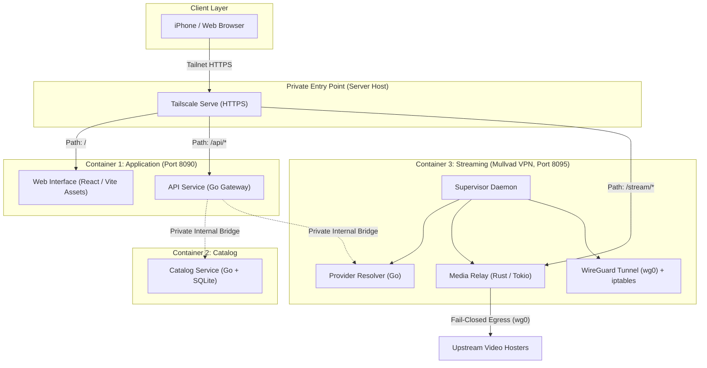
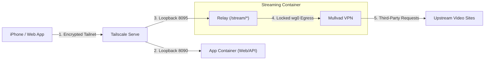

<div align="center">

# Stream TV Operations

**Production deployment, container orchestration, and automated updates.**

[Overview](#overview) &bull; [The 3 Containers](#the-three-containers) &bull; [Network & Security](#network-and-security) &bull; [Folder Structure](#folder-structure) &bull; [Releases & Rollback](#releases-and-rollback) &bull; [Documentation](#deployment-documentation)

---

</div>

## Overview

Think of this folder as the flight control tower for our home streaming server.

While the individual project folders in Stream TV contain the raw code for the app, the website, the database, and the video scrapers, the [deploy](deploy) repository is responsible for:

- Turning those codebases into **three lightweight Docker containers**.
- Running everything securely on our home Raspberry Pi server (named **Server**).
- Routing user traffic safely through an encrypted private tunnel (**Tailscale**).
- Forcing all video searches and streaming through **Mullvad VPN** so our home IP address never touches upstream sites.
- Automatically installing new updates when we push code to GitHub (`stv-*`).

---

## The Three Containers

Instead of running six separate containers, Stream TV deploys as **exactly three synchronized containers**:

<div align="center">



</div>

### Container Breakdown

| Container | What Is Inside | Plain English Purpose | Network & Storage Policy |
| :--- | :--- | :--- | :--- |
| **Application** | Go API + Pre-built Web Assets | **The Front Desk:** Serves the website files to browsers and manages user profiles, watch history, and playback authorization passes. | Runs outside the VPN. Stores API databases and signing keys in private persistent volumes. |
| **Catalog** | Go Metadata Service + SQLite Database | **The Librarian:** Manages movie and TV details, seasons, episodes, and recommendation shelves. Periodically syncs fresh data from TMDB. | Runs outside the VPN (talks directly to TMDB). Owns its SQLite database. Client devices fetch movie posters directly from TMDB's edge servers. |
| **Streaming** | Go Providers + Rust Relay + Mullvad Tunnel | **The Engine Room:** Finds video sources across multiple streaming websites, solves security challenges, and streams video segments. | **Strictly locked inside Mullvad VPN.** If the VPN tunnel drops for any reason, the firewall kills all outbound traffic instantly. |

---

## Network and Security

Stream TV uses a "fail-closed" defense-in-depth model so that personal data and internet traffic remain completely protected.

<div align="center">



</div>

1. **Private Ingress (Tailscale Serve):**
   - The server does not expose open ports to the public internet.
   - Devices connect exclusively over a secure Tailscale mesh network at `https://stream.example.com`.
   - Tailscale directs `/` to web files, `/api/*` to the Go API, and `/stream/*` directly to the Rust relay.

2. **Fail-Closed Privacy Guard (Mullvad VPN):**
   - All scraping and video segment downloading occur inside the `streaming` container.
   - Outbound traffic is bound directly to the `wg0` WireGuard tunnel interface.
   - If the VPN drops or disconnects, the kernel firewall immediately drops every outbound packet. Personal home IP addresses can never leak to third-party streaming sites.

3. **Isolated Media Pipeline:**
   - Client devices never communicate directly with upstream video hosts.
   - The Rust relay fetches video segments through the VPN, sanitizes HLS playlists, rewrites all links to local session paths, and streams them smoothly to the player.

---

## Folder Structure

The deployment repository is organized cleanly to separate configuration, automation, scripts, and documentation:

```
deploy/
├── compose.yaml              # Production Docker Compose blueprint (3 containers)
├── Dockerfile.application    # Application container definition (API + Web)
├── Dockerfile.catalog        # Catalog container definition (Go + SQLite)
├── Dockerfile.streaming      # Streaming container definition (Providers + Relay + VPN)
├── source-versions.json      # Pinned Git commit hashes for every component
├── README.md                 # This overview guide
├── AGENTS.md                 # Scoped instructions and safety boundaries for AI agents
├── .dockerignore             # Strict build context whitelist (keeps secrets out)
├── .gitignore                # Protects local state and keys from Git tracking
├── .env.example              # Documented environment variables for compose.yaml
│
├── artifacts/                # Compiled binary releases and built web assets
│   ├── api                   # Go API binary
│   ├── catalog               # Go Catalog binary
│   ├── providers             # Go Providers binary
│   └── web/                  # Production Vite/React HTML, JS, and CSS bundles
│
├── automation/               # Automated CI/CD deployment scripts
│   ├── release.py            # Zero-downtime deployment runner and rollback tool
│   └── setup-runners.py      # GitHub Actions self-hosted runner configuration
│
├── runtime/                  # Container startup and supervisor configs
│   ├── supervisord.ini       # Process supervisor for the streaming container
│   ├── streaming-entry.sh    # Entrypoint script enforcing VPN readiness
│   ├── catalog-entry.py      # Entrypoint script for catalog migrations
│   └── vpn-owner.py          # Root-privileged WireGuard manager and health guard
│
├── docs/                     # Detailed guides and operational documentation
│   ├── ACCEPTANCE.md         # Step-by-step verification and manual testing checklist
│   ├── AUTOMATIC_DEPLOYMENT.md # How push-to-main deployment works
│   ├── AUTOMATIC_RELEASES.md # Log of past releases and instant rollback commands
│   ├── DEPLOYED.md           # Deployment history and verification record
│   ├── DEPLOY_PROMPT.md      # Specification and requirements brief
│   └── workspace-overview.md # Complete architectural breakdown of the workspace
│
└── scripts/                  # Operations and maintenance shell scripts
    ├── README.md             # Execution target matrix (Mac vs. Pi) and guide
    ├── build-relay.sh        # Builds relay via Docker mounting relay/
    ├── cutover.sh            # One-click switch from legacy to V2 stack
    ├── rollback.sh           # One-click emergency rollback to legacy stack
    ├── activate-household.sh # Activates new API/web updates without login gates
    ├── rollback-household.sh # Reverts household access updates
    ├── finish-packaging.sh   # Builds relay and packages production artifacts
    ├── finish-routing.sh     # Sets up host Tailscale Serve routes
    ├── activate-components.py# Symlinks component releases atomically
    └── migrate-mac.py        # Migrates local Mac databases and keys to Pi format
```

---

## Releases and Rollback

### Independent Component Updates

Whenever you push new code to `main` in any of the individual project repositories (`stv-web`, `stv-api`, `stv-catalog`, `stv-providers`, or `stv-relay`), a GitHub Actions runner on the server automatically builds and deploys the new version:

- **Web updates:** Replaces static HTML/JS/CSS files without restarting any servers.
- **API updates:** Restarts only the `application` container; catalog and streaming stay up.
- **Catalog updates:** Restarts only the `catalog` container; active playback is not interrupted.
- **Provider updates:** Restarts only the scraper worker inside the streaming container; the relay and VPN tunnel remain alive.
- **Relay updates:** Restarts the relay process inside the streaming container while leaving the VPN tunnel connected.

### Emergency Rollback

Every deployment creates an automatic recovery snapshot before activating. If an update ever causes an issue, you can roll back instantly:

1. **Individual Component Rollback:** Run the specific rollback command provided in the GitHub Actions deployment summary or listed in [docs/AUTOMATIC_RELEASES.md](docs/AUTOMATIC_RELEASES.md).
2. **Whole Stack Rollback:** To revert all containers back to the original legacy release, run:
   ```bash
   ssh user@server.local 'sh /opt/stream-tv/current/scripts/rollback.sh'
   ```

---

## Deployment Documentation

Detailed operational guides are organized in the [docs/](deploy/docs) folder:

- [docs/ACCEPTANCE.md](docs/ACCEPTANCE.md): Complete testing checklist for verifying video playback, profiles, and VPN fail-closed behavior.
- [docs/AUTOMATIC_DEPLOYMENT.md](docs/AUTOMATIC_DEPLOYMENT.md): How push-to-main deployments, runner services, and file locking work.
- [docs/DEPLOYED.md](docs/DEPLOYED.md): Complete record of deployed commit SHAs, database migrations, and cutover details.
- [docs/DEPLOY_PROMPT.md](docs/DEPLOY_PROMPT.md): Original prompt specifications and architectural constraints.
- [docs/workspace-overview.md](docs/workspace-overview.md): High-level overview of the entire Stream TV ecosystem.
