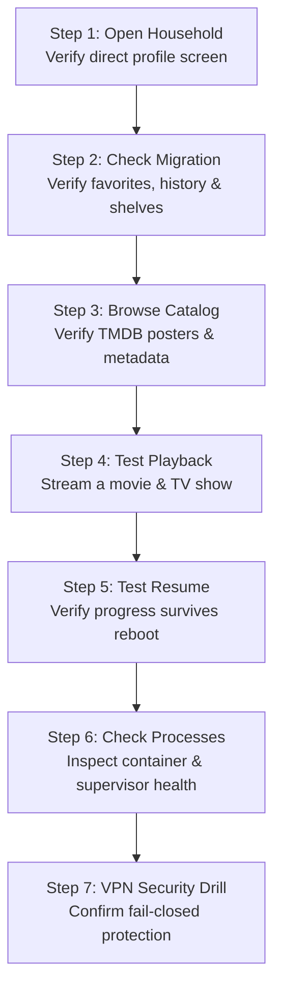

<div align="center">

# Operator Acceptance Checklist

**Step-by-step verification guide for the Stream TV deployment on the server.**

[Overview](#overview) &bull; [The 7 Verification Steps](#the-7-verification-steps) &bull; [Emergency Rollback](#emergency-rollback) &bull; [Component Releases](#manual-component-releases)

---

</div>

## Overview

Think of this document like a pre-flight inspection checklist before taking off.

The new Stream TV system has been packaged and installed on our home Raspberry Pi server (**Server**), your personal watch history and profiles from your Mac have been migrated over, and the network routes are set up.

Because an automated script cannot watch video or tell you how smooth playback feels on an actual screen, this guide gives you **7 clear, plain-English verification checks** to run on your iPhone and computer to verify that the home streaming setup is working 100%.

> [!NOTE]
> Access the home streaming service on your private network at:
> **`https://stream.example.com`** (Make sure your device is connected to your Tailscale network).

---

## The 7 Verification Steps

<div align="center">



</div>

### Step 1: Open the Household

- **How to test:** Open `https://stream.example.com` in a private/incognito browser window. On your iPhone, open the Stream TV app while connected to Tailscale.
- **What to expect:** You should immediately see the household profile selection screen (or jump straight into your profile). There is no username or password prompt, and no account setup screen.
- **Why this matters:** Stream TV uses private network authentication over Tailscale instead of annoying login screens for family members at home.

---

### Step 2: Check Your Watch History and Favorites

- **How to test:** Click into your personal profile. Look at your "Continue Watching" shelf, your Bookmarks, and your Favorites list.
- **What to expect:** Everything you had on your Mac should appear here exactly as before. The migration preserved 1 account, 1 profile, 7 custom lists, 1 progress record, and 2 activity logs.
- **Why this matters:** Confirms that all your past viewing history and settings were safely moved from your computer to the Raspberry Pi.

---

### Step 3: Browse Movie Posters and Details

- **How to test:** Scroll through the catalog, search for a title, and click into a movie or TV show detail page.
- **What to expect:** Title descriptions, cast information, seasons, and episodes should load smoothly. Movie posters should display clearly.
- **Why this matters:** The catalog service manages metadata locally in a SQLite database, while client devices load poster images directly from TMDB's edge servers. This keeps the home server fast and saves disk space.

---

### Step 4: Test Real Video Playback

- **How to test:** Play one movie and one TV episode. Test picture quality, audio tracks, subtitle toggle, seeking forward/backward 30 seconds, pausing, and resuming.
- **What to expect:** Video should buffer quickly (often in less than a second) and play in high-definition without stuttering. In your browser's developer network tab, all video segment requests should route cleanly under `/stream/`.
- **Why this matters:** Confirms that the Go provider service successfully resolved stream links and the Rust relay is securely packaging video through the VPN.

---

### Step 5: Test Resume and Server Restart Persistence

- **How to test:**
  1. Play a video for about one minute, then exit back to the home screen.
  2. Reload the page and make sure your resume position is saved.
  3. Next, from your Mac terminal, restart the server containers:
     ```bash
     ssh user@server.local 'cd /opt/stream-tv/current && docker compose restart'
     ```
  4. Reload the website or app.
- **What to expect:** Your profile, watch progress, and shelves should remain intact.
- **Why this matters:** Proves that server reboots or power outages will not wipe out your saved watch positions.

---

### Step 6: Inspect Server Container Health

- **How to test:** Run this command from your Mac terminal to inspect running processes on the server:
  ```bash
  ssh user@server.local 'cd /opt/stream-tv/current && docker compose ps && docker compose exec streaming supervisorctl -c /opt/runtime/supervisord.ini status'
  ```
- **What to expect:**
  - Three Docker containers should be running: `application`, `catalog`, and `streaming`.
  - Inside the `streaming` container, both `providers` and `relay` processes should show a status of **RUNNING**.
- **Why this matters:** Confirms that background worker processes are alive and monitored by the supervisor daemon.

---

### Step 7: Fail-Closed VPN Security Drill (Optional / Disruptive)

> [!CAUTION]
> This test temporarily halts video playback to prove that your real IP address cannot leak. Only run this when nobody else at home is actively watching.

- **How to test:**
  1. Start playing a video on your computer.
  2. In your terminal, intentionally disable the VPN interface:
     ```bash
     ssh user@server.local 'cd /opt/stream-tv/current && docker compose exec -u 0 streaming ip link set wg0 down'
     ```
  3. Observe what happens. Once the player finishes playing already-buffered seconds, new playback requests should stop immediately. Browsing the cached catalog will still work, but no new video searches or segments can leave the server.
  4. Restore normal operation by restarting the streaming container:
     ```bash
     ssh user@server.local 'cd /opt/stream-tv/current && docker compose restart streaming'
     ```
  5. Wait a few seconds for the WireGuard tunnel to reconnect, then start a video again. Playback should resume normally.
- **Why this matters:** This proves our "fail-closed" firewall rule. If Mullvad VPN ever crashes or loses internet connection, the firewall immediately blocks all traffic to guarantee your home IP is never exposed to third-party streaming sites.

---

## Emergency Rollback

If you ever encounter an issue and need to return immediately to the previous legacy deployment:

<div align="center">


</div>

Run this single command from your Mac:

```bash
ssh user@server.local 'sh /opt/stream-tv/current/scripts/rollback.sh'
```

### What Happens During Rollback
1. The new V2 containers stop cleanly. **None of your data is deleted.**
2. The legacy containers restart and reconnect to their original database volume.
3. Tailscale Serve automatically points back to the legacy service on port 3000.
4. Your existing household accounts and data remain preserved.

To return back to the new V2 stack after a rollback:
```bash
ssh user@server.local 'cd /opt/stream-tv/current && docker compose up -d --no-build && sh scripts/finish-routing.sh'
```

---

## Manual Component Releases

Components live under `components/<name>/<commit-sha>/` with an atomic `current` symlink. This allows updating individual services without restarting unrelated containers.

For example, to update the `providers` or `relay` binary on the server:

```bash
cd /opt/stream-tv/current

# 1. Stop the specific service gracefully
docker compose exec streaming supervisorctl -c /opt/runtime/supervisord.ini stop providers

# 2. Point the symlink to the new version
ln -s <NEW_COMMIT_SHA> components/providers/next
mv -Tf components/providers/next components/providers/current

# 3. Start the service back up
docker compose exec streaming supervisorctl -c /opt/runtime/supervisord.ini start providers
```

- **Provider updates:** Restarts only the provider scraper; the relay and VPN stay running.
- **Relay updates:** Restarts only the relay; the provider scraper and VPN stay running.
- **Catalog updates:** Restarts only the `catalog` container; active playback is not interrupted.
- **API updates:** Restarts only the `application` container.
- **Web updates:** Replaces static HTML/JS assets in place with zero server restarts.
