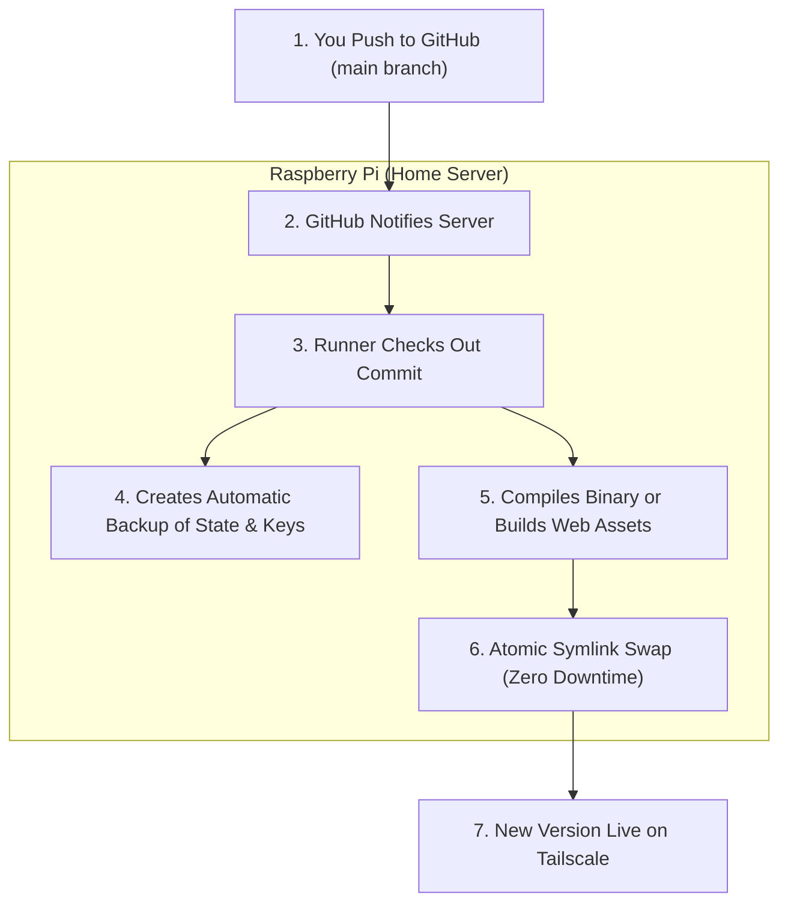

<div align="center">

# Push-to-Main Automatic Deployment

**How code changes in GitHub automatically deploy to the home server.**

[Overview](#overview) &bull; [How It Works](#how-automatic-deployment-works) &bull; [Component Pipelines](#what-happens-for-each-component) &bull; [Instant Rollback](#instant-rollback-and-pausing) &bull; [Post-Update Checks](#what-to-check-after-an-update)

---

</div>

## Overview

Think of this like an automated delivery conveyor belt running directly from your computer to your home server.

Whenever you finish working on a feature or fixing a bug, you don't need to manually SSH into the Raspberry Pi, copy files, or rebuild complex containers. 

Instead, all you do is push your code to GitHub:

```bash
git add .
git commit -m "Describe your feature or fix"
git push origin main
```

A private, self-hosted background worker (a **GitHub Actions runner**) running on **Server** catches the update, compiles the code locally on the Pi, creates an automatic backup of your existing data, and switches to the new version in seconds.

---

## How Automatic Deployment Works

<div align="center">



</div>

1. **Push-Triggered:** Deployments run only on direct pushes to `main` (or when manually triggered in GitHub's Actions tab). Pull requests do not trigger deployments.
2. **Dedicated Runners:** Each project (`web`, `api`, `catalog`, `providers`, and `relay`) has its own lightweight runner service running natively on the Raspberry Pi under the `dev` user.
3. **Host Lock Protection:** Only one component deploys at a time. A host file lock ensures that two simultaneous pushes never collide or corrupt files.
4. **Build Safety:** If a build fails or has a compilation error, nothing changes on the server. The current version keeps running uninterrupted.

---

## What Happens for Each Component

Each part of Stream TV has unique requirements when updating:

| Component | Repository | Build Process | Downtime & Restart Impact |
| :--- | :--- | :--- | :--- |
| **Web Client** | `family-stream-web` | Built with Bun into optimized HTML/JS/CSS bundles. | **Zero downtime.** Assets are copied into the web mount and `index.html` is replaced atomically. Open browser tabs continue working smoothly. |
| **Public API** | `family-stream-api` | Compiled as an ARM64 Go binary inside an isolated temporary builder. | **Brief restart (~2 seconds).** Only the `application` container restarts. Catalog, providers, relay, and VPN stay completely up. |
| **Catalog** | `family-stream-catalog` | Compiled as an ARM64 Go binary. | **Brief restart (~2 seconds).** Only the `catalog` container restarts. Ongoing video playback is not affected. |
| **Providers** | `family-stream-providers` | Compiled as an ARM64 Go binary. | **Zero container restarts.** The supervisor daemon restarts only the provider scraper worker inside the streaming container. Relay and VPN remain untouched. |
| **Relay** | `family-stream-relay` | Compiled as an ARM64 Rust binary with Cargo. | **Zero container restarts.** The supervisor daemon restarts only the relay process. The VPN tunnel remains connected. |

---

## Instant Rollback and Pausing

Every successful deployment saves an exact snapshot of the previous binary, configuration, and database state under `/opt/stream-tv/backups/automatic/`.

### 1. One-Command Rollback

At the end of every deployment, GitHub Actions prints the exact rollback command in the run summary:

```bash
ssh user@server.local 'python3 /opt/stream-tv/automation/release.py rollback /opt/stream-tv/automation/history/RECORD.json'
```

- Instantly restores the previous working binary.
- Keeps all new watch history and profile data created in the meantime.
- Refuses to run if someone has already deployed a newer version to prevent accidental overwrites.

### 2. Pausing Deployments

If you are doing heavy code refactoring and want to temporarily pause automatic updates:

- **Per Repository:** Go to GitHub **Actions &rarr; Deploy &hellip; to the server &rarr; &hellip; (three dots) &rarr; Disable workflow**.
- **Server-Wide:** Stop the runner services on the Raspberry Pi:
  ```bash
  ssh -t user@server.local 'for component in web api catalog providers relay; do cd /opt/stream-tv/automation/runners/$component && sudo ./svc.sh stop; done'
  ```
  *(To resume later, run the same command replacing `stop` with `start`)*.

---

## What to Check After an Update

Whenever an automatic deployment completes:

1. **Check the GitHub Actions Summary:** Make sure the green checkmark appears and the commit hash matches what you pushed.
2. **Open the Website:** Go to `https://stream.example.com` while connected to Tailscale. Confirm your changes appear (for web updates) or profiles load immediately.
3. **Verify Your Profile:** Check your "Continue Watching" shelf, bookmarks, and favorites.
4. **Play a Video:** Play a quick movie or TV episode to confirm that stream resolution and playback remain fast and smooth.
