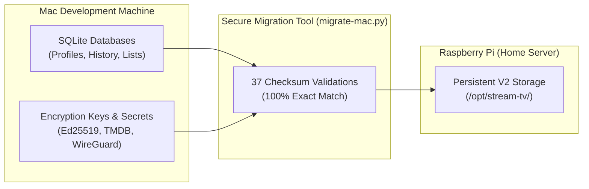

# Production Deployment Record

**Historical log of the initial V2 stack cutover and household access rollout.**

[Overview](#overview) &bull; [Deployed Versions](#deployed-component-versions) &bull; [Migration Summary](#mac-to-pi-migration-summary) &bull; [Network Routes](#private-network-routes) &bull; [Household Access](#household-access-update)

---

## Overview

Think of this document as the official birth certificate and permanent service record for our home streaming server.

On October 17, 2026, the Stream TV V2 architecture was successfully cut over to the Raspberry Pi (**Server**). Your personal watch history, movie bookmarks, and encryption keys from your Mac were safely moved over, the new three-container Docker stack was launched, and network routing was configured through Tailscale.

Later that same day, we pushed the "Household Access" update, which eliminated annoying password prompts so your family can jump straight into their watching profiles.

---

## Deployed Component Versions

Below are the exact Git commit hashes of each project deployed during the initial release:

| Component | Repository | Deployed Commit SHA | Runtime Responsibility |
| :--- | :--- | :--- | :--- |
| **API** | `family-stream-api` | `8b476e7` | Manages accounts, profiles, watch history, and playback passes |
| **Catalog** | `family-stream-catalog` | `cfe4e5d` | SQLite database storing movie/TV metadata and recommendations |
| **Providers** | `family-stream-providers` | `7e3c31c` | Pure-Go scrapers resolving streaming sources across multiple sites |
| **Relay** | `family-stream-relay` | `03c3080` | Rust engine delivering video segments inside Mullvad VPN |
| **Web** | `family-stream-web` | `fede77e` | Modern React/Vite web application bundle |

---

## Mac to Pi Migration Summary

When moving Stream TV from your Mac to the Raspberry Pi, we didn't start from an empty database. All your personal data was transferred seamlessly:

1. **What Was Preserved:**
   - 1 household account and personal profile.
   - 7 custom lists and bookmark shelves.
   - Complete watch history and resume progress records.
   - Matching database encryption keys, Ed25519 signing keys, and private service bearer tokens.
   - Full TMDB catalog cache and WireGuard VPN credentials.
2. **Data Integrity:** All 37 file transfer checksums matched with 100% precision before server startup.
3. **Safety Guarantee:** The original Mac database files were left untouched and writers were stopped so that Mac data and Pi data would not accidentally diverge.

---

## Private Network Routes

The dev account was authorized as the Tailscale operator on the server. Tailscale Serve maps incoming private requests from your devices directly to the container ports:

| Public URL Path | Destination Port | Responsible Service |
| :--- | :--- | :--- |
| `https://stream.example.com/` | `http://127.0.0.1:8090` | Web application static files (HTML/CSS/JS) |
| `https://stream.example.com/api/*` | `http://127.0.0.1:8090/api` | Go API (profiles, search, shelves, history) |
| `https://stream.example.com/stream/*` | `http://127.0.0.1:8095/stream` | Rust media relay (video segments through VPN) |

> [!NOTE]
> Tailscale Serve handles TLS encryption automatically. No ports are opened to the public internet, and no public Funnel access is allowed.

---

## Household Access Update

Shortly after the initial cutover, we updated the system to make it feel like a real household entertainment system:

- **No More Passwords at Home:** Account password prompts were removed. When you open the web app or the native iPhone app, it opens directly into the household profile screen.
- **Data Association Preserved:** Even though you don't have to type a password, the API automatically associates your activity with your existing household profile, so your watch history, favorites, and continue-watching shelves remain intact.
- **Isolated Component Restart:** Only the `application` container was restarted for this update; the `catalog` and `streaming` containers remained running without interruption.

---

## Legacy System Safety and Rollback

The old deployment was retired safely without deleting anything:

- The old proof-of-concept containers were stopped and their automatic restart was turned off.
- The original Docker volume (`family_stream_data`) was preserved completely intact.
- A full archive of the legacy configuration, images, and data was stored under `/opt/stream-tv/backups/pre-v2/`.
- If an emergency ever requires rolling back to the old system, running `scripts/rollback.sh` will bring it right back up.
