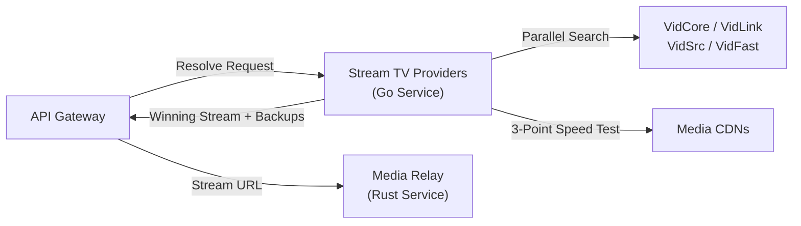

<!--
  README.md
  Stream TV Providers Service

  Created by ChrisRodStar.

  Summary:
  Primary documentation and technical overview for the Stream TV provider
  resolution and media stream probing service.
-->

<div align="center">

# Stream TV Providers

**Native Go provider registry, parallel media stream resolution, and real-time HLS/MP4 stream probing.**

[Overview](#overview) &bull; [Key Capabilities](#key-capabilities) &bull; [Architecture](#architecture) &bull; [Service Layout](#service-layout) &bull; [Quick Start](#quick-start) &bull; [Documentation](#documentation)

---

</div>

## Overview

The Stream TV Provider service is an independent, high-performance Go service responsible for finding, testing, and ranking video streams for movies and television episodes.

When a user selects a title in Stream TV, the public API sends the canonical The Movie Database (TMDB) title ID, media type, season and episode numbers, and language preferences to this service. The provider service queries four native providers at the same time, tests candidate video files directly over the network to verify that they work, measures their actual download speeds, and returns the highest quality working stream alongside ordered backup streams.



> [!NOTE]
> The provider service discovers and tests video links. It does not relay or stream video chunks to user devices; the Rust media relay handles all streaming traffic.

---

## Key Capabilities

1. **Four Native Go Adapters:** Implements dedicated adapters for **VidCore**, **VidLink**, **VidSrc**, and **VidFast**. None of the adapters use JavaScript or WebAssembly runtimes; all token derivations, session challenges, and cryptographic steps run directly in native Go.
2. **Parallel Search and In-Flight Deduplication:** Dispatches lookups across all four providers concurrently. If multiple clients request the exact same episode at the same time, the service coalesces them into a single search to prevent duplicate traffic.
3. **Active 3-Point Media Probing:** Tests video streams directly before sending them to the client. Samples three evenly spaced video segments (beginning, middle, and end) to measure real-world download speed and latency without relying on optimistic CDN startup caching.
4. **Deterministic 6-Tier Ranking:** Ranks working streams using a strict, unbiased quality policy: language match first, verified 1.5x bandwidth headroom second, highest resolution third, and server reliability fourth.
5. **Fail-Closed VPN Security:** Pins all outbound network sockets directly to the local Mullvad VPN network interface at the operating system kernel level (`IP_BOUND_IF` on macOS, `SO_BINDTODEVICE=wg0` on Linux). If the VPN disconnects, traffic drops instantly to prevent leaking the user's home IP address.
6. **Socket-Level SSRF Defenses:** Inspects all resolved IP addresses before establishing TCP connections, automatically blocking private, local, and cloud metadata network ranges.

---

## Architecture

The service operates as a self-contained daemon listening on a private loopback address (`127.0.0.1:8093`) with Bearer token authentication.

```text
POST /internal/v1/resolve
  │
  ├── 1. Ingress Validation (Schema, TMDB ID, Season/Episode coordinates)
  ├── 2. Deduplication & In-Flight Tracking (Shares identical concurrent requests)
  ├── 3. Parallel Search Coordinator (Queries VidCore, VidLink, VidSrc, VidFast)
  ├── 4. Overlapped Media Prober (Tests video segments via Mullvad VPN sockets)
  ├── 5. 6-Tier Selection Engine (Sorts streams by language, headroom, and resolution)
  └── 6. Output Delivery (Returns selected stream and ordered backup candidates)
```

For complete technical diagrams and package lifecycle details, read the [Architecture Guide](docs/ARCHITECTURE.md).

---

## Service Layout

The repository is structured into clear packages with strict boundaries:

- `cmd/providers/`: Main production service entry point.
- `cmd/providers-netcheck/`: Network diagnostic tool to verify Mullvad VPN exit attestation before startup.
- `internal/config/`: Configuration loader and engine initialization.
- `internal/model/`: Core domain models for titles, coordinates, streams, observations, and results.
- `internal/network/`: Shared HTTP client with connection pooling, socket-level SSRF defense, and VPN socket pinning.
- `internal/probe/`: HLS and MP4 media probers with 3-point segment testing and byte budgets.
- `internal/provider/`: Adapter interface, registry, and capabilities.
  - `internal/provider/vidcore/`: Native VidCore adapter (AES-256-CBC, RC4, AES-256-GCM).
  - `internal/provider/vidlink/`: Native VidLink adapter (SHA-256 WASM verification, static token derivation).
  - `internal/provider/vidsrc/`: Native VidSrc adapter (Multi-stage embed gate, ChaCha20 decryption).
  - `internal/provider/vidfast/`: Native VidFast adapter (Bundle verification, AES-256-GCM unlock).
- `internal/search/`: Parallel search coordinator, timeouts, and in-flight deduplication.
- `internal/selection/`: Eligibility rules and the deterministic 6-tier ranking engine.
- `internal/cache/`: Bounded, expiring in-memory caches for stream candidates and recent speed tests.
- `internal/transport/http/`: Private HTTP server with health checks (`/health/livez`, `/health/readyz`) and resolution endpoint.
- `config/`: Example JSON configuration templates.
- `docs/`: In-depth technical guides and operational runbooks.

---

## Quick Start

### 1. Requirements
- Go 1.24 or later
- Connected Mullvad VPN tunnel (`utun...` on macOS, `wg0` on Linux)

### 2. Configuration
Copy the sample environment file:
```bash
cp .env.example .env
```

### 3. Verify VPN Network Egress
Run the netcheck utility to confirm that outbound sockets properly exit through the Mullvad tunnel:
```bash
go run ./cmd/providers-netcheck config/providers.json
```

### 4. Build and Run
Build the service binary:
```bash
go build -o bin/providers ./cmd/providers
./bin/providers config/providers.json
```

### 5. Check Service Health
```bash
curl -H "Authorization: Bearer $(cat config/bearer_token.txt)" http://127.0.0.1:8093/health/readyz
```
Expected response:
```json
{"status":"ready"}
```

---

## Documentation

Comprehensive engineering documentation is maintained in the `docs/` directory:

- [System Architecture](docs/ARCHITECTURE.md): Package breakdown, request lifecycle, concurrency controls, and data models.
- [Provider Specifications](docs/PROVIDERS.md): Detailed request flows, token algorithms, and cryptographic details for all four adapters.
- [Probing and Selection Policy](docs/SELECTION_AND_PROBING.md): 3-point segment testing, bandwidth metrics, eligibility rules, and the 6-tier ranking policy.
- [Operations and Maintenance](docs/OPERATIONS.md): Configuration reference, HTTP API specs, fail-closed VPN security, graceful shutdown, and troubleshooting runbook.
- [Baseline Benchmarks](docs/BENCHMARKS.md): Measured provider latencies, candidate counts, and pipeline performance before repository migration.

