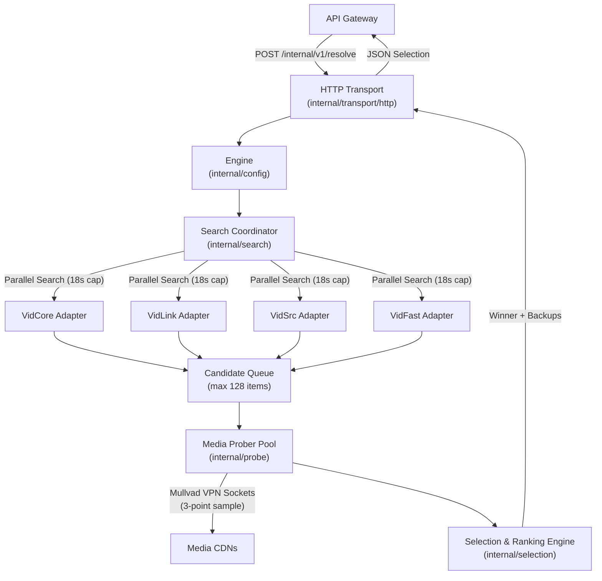

<!--
  ARCHITECTURE.md
  Stream TV Providers Service

  Created by ChrisRodStar.

  Summary:
  System architecture, internal package structure, parallel resolution pipeline,
  and request lifecycle for the Stream TV provider service.
-->

# Stream TV Providers Architecture

**How the provider service searches for media streams, probes video files, and ranks playback candidates.**

[Overview](#overview) &bull; [Package Directory](#package-directory) &bull; [Request Lifecycle](#request-lifecycle) &bull; [Concurrency and Deduplication](#concurrency-and-deduplication) &bull; [Data Models](#data-models) &bull; [Memory and Caching](#memory-and-caching)

---

## Overview

The Stream TV Provider service is a standalone Go service responsible for finding, testing, and ranking video streams for movies and television episodes.

When a user selects a title to watch, the public API sends a request containing the canonical The Movie Database (TMDB) title ID, media type, season and episode numbers, and user language preferences. The provider service queries four native providers at the same time, tests the candidate video files directly over the network to verify that they work, measures their actual download speeds, and returns the highest quality working stream alongside ordered backup streams.

### System Boundaries

To keep the system reliable and simple, the provider service has clear operational boundaries:

1. **Source Discovery and Probing Only:** This service only discovers video URLs and tests them. It does not relay or stream video chunks to phones, tablets, or web browsers. The Rust media relay handles all streaming traffic.
2. **Native Go Execution:** All four providers are implemented in native Go. The service does not use Node.js, Bun, or an external JavaScript execution engine to run website scripts.
3. **Fail-Closed Networking:** All outbound network traffic to third-party streaming sites is bound to the Mullvad VPN tunnel at the operating system socket level. If the VPN disconnects, network requests fail immediately rather than exposing the home IP address.

---

## Package Directory

The codebase is organized into clear packages with specific responsibilities:

| Directory | Package | Responsibility |
| :--- | :--- | :--- |
| `cmd/providers/` | `main` | Production service binary. Reads JSON configuration, binds the local HTTP listener, and manages graceful shutdown. |
| `cmd/providers-netcheck/` | `main` | Diagnostic CLI tool. Verifies that outbound network sockets properly exit through the Mullvad VPN tunnel before service startup. |
| `internal/config/` | `config` | Loads environment settings and JSON configuration files, constructs the engine, and wires together all subsystems. |
| `internal/model/` | `model` | Core domain structures: titles, episode coordinates, stream candidates, probe observations, preferences, and results. |
| `internal/network/` | `network` | Shared HTTP client with connection pooling, socket-level SSRF defenses, and platform-specific Mullvad VPN socket binding. |
| `internal/probe/` | `probe` | Media prober. Downloads HLS playlists, verifies variant streams, and measures download speeds across multiple video segments. |
| `internal/provider/` | `provider` | Provider adapter interface, registry, and capabilities declarations. |
| `internal/provider/vidcore/` | `vidcore` | Native adapter for VidCore. Decodes session challenges and decrypts server lists. |
| `internal/provider/vidlink/` | `vidlink` | Native adapter for VidLink. Validates WebAssembly fingerprints and generates session tokens. |
| `internal/provider/vidsrc/` | `vidsrc` | Native adapter for VidSrc. Resolves multi-stage embeds and decrypts ChaCha20 stream lists. |
| `internal/provider/vidfast/` | `vidfast` | Native adapter for VidFast. Resolves dynamic bundle assets and unlocks AES-GCM server responses. |
| `internal/search/` | `search` | Coordinates concurrent searches across all registered providers, manages timeouts, and deduplicates in-flight requests. |
| `internal/selection/` | `selection` | Evaluates probed stream metrics and applies the deterministic 6-tier ranking policy. |
| `internal/cache/` | `cache` | Thread-safe, expiring in-memory caches for raw candidate streams and verified probe observations. |
| `internal/transport/http/` | `http` | Private authenticated HTTP API server exposing health checks and the resolution endpoint. |

---

## Request Lifecycle

Every resolution request goes through six distinct steps:

### 1. Ingress Validation
The request arrives at `POST /internal/v1/resolve` with a Bearer authentication token. The HTTP handler validates:
- The payload size is under 32 KiB.
- The title ID is a valid positive integer.
- The media type is either `movie` or `tv`.
- If the title is a TV show, the season number is non-negative and the episode number is positive.
- The `context_key` header is present and between 1 and 128 characters (used to isolate user sessions).

### 2. Deduplication and Cache Check
The search coordinator checks if an identical search is currently running or recently cached:
- **Cache Hit:** If working candidates for this title were discovered within the last 20 seconds, they are retrieved from memory, skipping upstream provider requests.
- **In-Flight Coalescing:** If another client requested the exact same title milliseconds earlier, the new request joins the running search rather than creating duplicate upstream traffic.

### 3. Parallel Provider Search
The coordinator launches all four provider adapters (VidCore, VidLink, VidSrc, and VidFast) simultaneously in separate goroutines:
- Each adapter has an individual timeout of 18 seconds.
- The total search deadline is 25 seconds.
- Adapters execute their reverse-engineered protocol steps to unlock stream URLs.
- Discovered candidates are normalized into standard `model.Candidate` records and pushed into the candidate queue.

### 4. Overlapped Media Probing
As soon as a candidate arrives in the queue, an available worker in the prober pool begins testing it immediately without waiting for slower providers to finish:
- **HLS Streams:** The prober fetches the master playlist, finds all resolution variants (1080p, 720p, 480p), and samples three video segments (first, middle, last) to measure actual download speed.
- **MP4 Streams:** The prober issues an HTTP range request to verify byte-range support and download speed.
- Outbound probe traffic respects a strict cumulative byte budget (4 MB total per search) to conserve network bandwidth.

### 5. Deterministic Ranking
Once candidates are probed, the selection engine filters out invalid streams (such as dead links, streams without enough bandwidth headroom, or mismatched languages). Working streams are sorted using a strict 6-tier policy:
1. Exact language match (audio first, then subtitles).
2. Proven bandwidth headroom (known bitrate with at least 1.5x measured delivery speed).
3. Highest resolution (1080p beats 720p).
4. Within-tier score (bandwidth headroom and server reliability).
5. Lowest time-to-first-byte (TTFB) latency.
6. Deterministic tiebreak on source ID.

### 6. Response Delivery
The server constructs a JSON response containing the top winning stream (`selected`) and an ordered list of backup streams (`backups`). The API gateway forwards this information to the media relay to begin video playback.

---

## Concurrency and Deduplication

Video searching involves slow third-party websites. To keep the service fast and stable, the system uses strict concurrency controls:

### Deduplication (`internal/search/dedup.go`)
When multiple household members click the same episode at the same time, the coordinator groups them using an in-flight tracker. Only one set of provider requests is sent. All waiting requests receive a copy of the final result once probing completes. If a client cancels their request, background work continues until all attached clients disconnect.

### Timeouts and Deadlines (`internal/search/deadline.go`)
- **Total Request Timeout:** 25 seconds.
- **Adapter Timeout:** 18 seconds.
- **Individual Probe Timeout:** 6 seconds per stream.
- **Server Unlock Timeout:** 3 seconds per server.

If an individual provider hangs or takes longer than 18 seconds, the coordinator drops that provider and finishes ranking the streams returned by the other three providers.

---

## Data Models

The core data structures in [internal/model/](providers/internal/model) define how data moves through the service:

### Title Identity (`title.go`)
Identifies the exact video requested:
- `TMDBID` (integer): Canonical title identifier.
- `Type` (string): `movie` or `tv`.
- `Season` (integer): TV season number (0 for specials, 1+ for regular seasons).
- `Episode` (integer): TV episode number (1+).
- `IMDbID` (string, optional): External cross-reference ID (such as `tt2861424`).
- `MALID` (integer, optional): MyAnimeList ID for anime titles.

### Candidate Stream (`source.go`)
Represents an unverified stream returned by a provider:
- `ID` (string): Unique identifier for the stream candidate.
- `Provider` (string): Name of the provider adapter (`vidcore`, `vidlink`, `vidsrc`, `vidfast`).
- `URL` (string): Direct URL to the media playlist or video file.
- `Format` (string): Media format (`hls` or `mp4`).
- `Headers` (map): HTTP headers required by the video CDN (such as `Referer` or `User-Agent`).
- `ExpiresAt` (time, optional): Timestamp when the stream URL expires.

### Probe Observation (`source.go`)
Records real-world measurements taken by the prober:
- `Width` and `Height` (integers): Video frame dimensions (such as 1920x1080).
- `Bitrate` (integer): Declared stream bitrate in bits per second.
- `DeliveryBitrate` (integer): Measured download speed in bits per second.
- `TTFBMs` (integer): Time-to-first-byte latency in milliseconds.
- `AudioLanguages` (list of strings): Detected audio track languages (such as `eng`).
- `Subtitles` (list of subtitle records): Available subtitle tracks with language and format.

### Selection Result (`result.go`)
The final output returned to the caller:
- `Selected` (RankedSource): The primary stream chosen for playback.
- `Backups` (list of RankedSource): Ordered list of alternative streams ready for instant failover if the primary stream fails during playback.

---

## Memory and Caching

To minimize CPU usage and prevent garbage collection pauses, the service uses lightweight, bounded in-memory caches:

### Candidate Cache (`internal/cache/sources.go`)
Stores raw stream candidates returned by adapters:
- Capacity: 128 entries.
- Time-to-Live (TTL): 20 seconds (or 5 seconds before the stream's declared expiration time, whichever is shorter).
- Clones nested data structures directly to avoid slow JSON serialization during read operations.

### Probe Observation Cache (`internal/cache/observations.go`)
Remembers recent speed and quality tests:
- Capacity: 64 entries (capped at 4 MB total memory).
- Time-to-Live (TTL): 15 seconds.
- Before reusing cached probe results, the prober performs a quick 4 KiB access check to verify that the video CDN link has not expired. If the check fails, the cached entry is evicted and a fresh probe is performed.

### Connection Reuse (`internal/network/client.go`)
The shared HTTP transport maintains an idle TCP connection pool (`MaxIdleConns: 100`, `MaxIdleConnsPerHost: 20`, `IdleConnTimeout: 90s`). This eliminates redundant TLS handshakes when requesting multiple video segments from the same media host.
