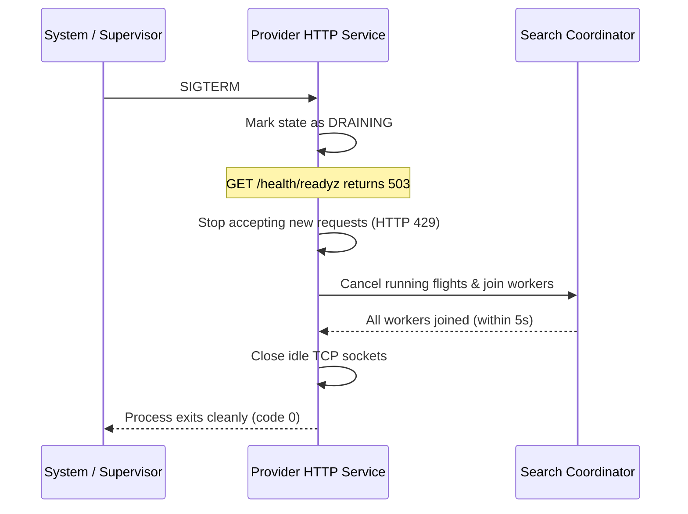

<!--
  OPERATIONS.md
  Stream TV Providers Service

  Created by ChrisRodStar.

  Summary:
  Operational reference for running, configuring, securing, and maintaining
  the Stream TV provider resolution service.
-->

<div align="center">

# Provider Operations & Maintenance

**Configuration, HTTP API endpoints, fail-closed Mullvad VPN security, healthchecks, and troubleshooting.**

[Overview](#overview) &bull; [Configuration Reference](#configuration-reference) &bull; [HTTP API Endpoints](#http-api-endpoints) &bull; [Fail-Closed VPN Security](#fail-closed-vpn-security) &bull; [Graceful Shutdown](#graceful-shutdown) &bull; [Troubleshooting Runbook](#troubleshooting-runbook)

---

</div>

## Overview

The Stream TV Provider service is an autonomous, high-performance Go daemon designed to run alongside the Rust media relay in the streaming container.

To ensure strict privacy and security:
- The HTTP server listens exclusively on the local loopback address (`127.0.0.1`) and is never exposed directly to the public internet.
- All requests require an authenticated Bearer token.
- All outbound network calls to third-party streaming sites are bound to the Mullvad VPN tunnel at the socket level.

---

## Configuration Reference

The service is configured using a strict JSON file. A template is provided in `config/providers.example.json`.

```json
{
  "listen": "127.0.0.1:8093",
  "bearer_token_file": "/run/secrets/provider_bearer_token",
  "vpn_interface": "wg0",
  "total_timeout_ms": 25000,
  "adapter_timeout_ms": 18000,
  "probe_budget_bytes": 4194304,
  "max_active_flights": 64,
  "candidate_cache_ttl_sec": 20
}
```

### Parameter Reference

| Field | Default Value | Description |
| :--- | :--- | :--- |
| `listen` | `127.0.0.1:8093` | Loopback IP address and port where the HTTP server listens. Remote or wildcard binds (`0.0.0.0`) are intentionally rejected. |
| `bearer_token_file` | *(Required)* | File path to a plain text file containing the secret authorization token (between 32 and 4096 ASCII characters without a trailing newline). Must have mode `0600`. |
| `vpn_interface` | *(Platform)* | Name of the Mullvad VPN network interface (`wg0` on Linux, `utun...` on macOS). |
| `total_timeout_ms` | `25000` (25s) | Hard deadline for the entire search and probe cycle. If exceeded, the server returns HTTP 504. |
| `adapter_timeout_ms` | `18000` (18s) | Maximum time allowed for any individual provider adapter to search before being dropped. |
| `probe_budget_bytes` | `4194304` (4 MB) | Maximum cumulative download volume allowed for testing video segments per request. |
| `max_active_flights` | `64` | Maximum number of concurrent unique title searches allowed in memory. |
| `candidate_cache_ttl_sec`| `20` (20s) | In-memory cache duration for raw candidate streams returned by adapters. |

> [!IMPORTANT]
> The configuration file and bearer token file must have strict permissions (file mode `0600`, directory mode `0700`). The service will refuse to start if secrets are readable by other system users.

---

## HTTP API Endpoints

All endpoints require the following HTTP header:
```text
Authorization: Bearer <secret-token>
```

### 1. Process Liveness (`GET /health/livez`)
Checks whether the Go process is running. This endpoint does not check network connections.

- **Success Response (HTTP 200):**
  ```json
  {
    "status": "live"
  }
  ```

### 2. Service Readiness (`GET /health/readyz`)
Checks whether the service is ready to resolve titles. It confirms the Mullvad VPN tunnel is active and the engine is initialized. It does not contact third-party streaming sites.

- **Success Response (HTTP 200):**
  ```json
  {
    "status": "ready"
  }
  ```
- **VPN Down Response (HTTP 503):**
  ```json
  {
    "status": "vpn_unavailable",
    "error": "mullvad interface wg0 is not active"
  }
  ```
- **Draining Response (HTTP 503):**
  ```json
  {
    "status": "draining"
  }
  ```

### 3. Resolve Media Stream (`POST /internal/v1/resolve`)
Searches all providers, probes candidate streams, and returns the highest quality stream with backup options.

#### Request Headers
- `Content-Type: application/json`
- `Authorization: Bearer <token>`

#### Request Body Example
```json
{
  "version": "providers.v1",
  "context_key": "user-session-98765",
  "title": {
    "tmdb_id": 60625,
    "type": "tv",
    "season": 1,
    "episode": 1,
    "imdb_id": "tt2861424"
  },
  "preferences": {
    "audio_languages": ["eng"],
    "subtitle_languages": ["eng"]
  },
  "device": {
    "max_height": 1080,
    "supported_codecs": ["avc1", "hev1", "mp4a.40.2"],
    "supported_containers": ["hls", "mp4"]
  },
  "startup_height": 1080
}
```

#### Response Body Example
```json
{
  "version": "providers.v1",
  "selected": {
    "source_id": "vidcore-supreme-1080p",
    "provider": "vidcore",
    "url": "https://cdn.example.com/stream/master.m3u8",
    "format": "hls",
    "headers": {
      "Referer": "https://vidcore.io/"
    },
    "observation": {
      "width": 1920,
      "height": 1080,
      "bitrate": 5840000,
      "delivery_bitrate": 18050000,
      "ttfb_ms": 142,
      "samples_completed": 3,
      "sample_bytes": 384000
    }
  },
  "backups": [
    {
      "source_id": "vidfast-server1-1080p",
      "provider": "vidfast",
      "url": "https://cdn.faststream.vc/live/master.m3u8",
      "format": "hls",
      "headers": {
        "Referer": "https://vidfast.vc/"
      },
      "observation": {
        "width": 1920,
        "height": 1080,
        "bitrate": 5200000,
        "delivery_bitrate": 16400000,
        "ttfb_ms": 185,
        "samples_completed": 3,
        "sample_bytes": 384000
      }
    }
  ]
}
```

If no eligible stream could be found or all candidates failed probing, `selected` is `null` and the reason is recorded in the `diagnostics` field.

---

## Fail-Closed VPN Security

To protect user privacy, the service enforces fail-closed network routing directly at the operating system socket layer:

### Why Socket Binding is Required
Standard operating system routing tables can accidentally route traffic over standard local network interfaces (Ethernet or Wi-Fi) if a VPN connection drops. 

To eliminate this risk, the provider service pins every outbound raw socket directly to the VPN network interface:
- **macOS:** Sets `IP_BOUND_IF` (IPv4) and `IPV6_BOUND_IF` (IPv6) socket options to the tunnel interface index.
- **Linux:** Sets `SO_BINDTODEVICE=wg0` on raw sockets using the `CAP_NET_RAW` Linux capability.

If the Mullvad VPN tunnel drops or is stopped, the operating system kernel instantly drops the socket with an `ENETDOWN` or `EHOSTUNREACH` error. Outbound traffic can never exit through unencrypted home network interfaces.

### Socket-Level SSRF Prevention
Before any HTTP connection is established, the custom `net.Dialer.Control` hook inspects the resolved IP address to block Server-Side Request Forgery (SSRF) and DNS rebinding attacks:

The dialer denies connection to all private and reserved IP ranges:
- `127.0.0.0/8` and `::1/128` (Loopback)
- `10.0.0.0/8`, `172.16.0.0/12`, `192.168.0.0/16` (Private RFC 1918)
- `169.254.0.0/16` and `fe80::/10` (Link-Local / Cloud Metadata)
- `100.64.0.0/10` (Carrier-Grade NAT RFC 6598)
- `fc00::/7` (Unique Local Address RFC 4193)
- `224.0.0.0/4` and `ff00::/8` (Multicast)

---

## Graceful Shutdown

When the service receives a `SIGINT` or `SIGTERM` signal:



1. **State Marked Draining:** `GET /health/readyz` begins returning HTTP 503 so upstream load balancers stop sending new traffic.
2. **Admission Closed:** New resolution requests receive immediate HTTP 429 responses.
3. **In-Flight Draining:** Active search and probe goroutines are given up to 5 seconds to finish their current work.
4. **Clean Exit:** Once all in-flight workers join, network sockets are closed and the process terminates cleanly.

---

## Troubleshooting Runbook

| Symptom | Probable Cause | Corrective Action |
| :--- | :--- | :--- |
| **HTTP 401 Unauthorized** | Missing or incorrect token in the `Authorization: Bearer` header. | Verify the bearer token matches the contents of `bearer_token_file`. |
| **HTTP 429 Overloaded** | More than 8 concurrent resolution handlers are active simultaneously. | The upstream API should implement short client-side retry backoffs. |
| **HTTP 503 vpn_unavailable** | The Mullvad VPN tunnel is disconnected or the network interface disappeared. | Check the VPN service status (`mullvad status`). Verify the tunnel interface (`wg0` or `utun`) exists. |
| **HTTP 504 Gateway Timeout** | Upstream providers took longer than the 25-second total request deadline. | Check if home internet connectivity is degraded or if third-party streaming sites are experiencing outages. |
| **Empty `selected` field** | Candidates were found but all failed 3-point segment probing or headroom checks. | Inspect the `diagnostics` section of the response to see why candidate streams were rejected. |
