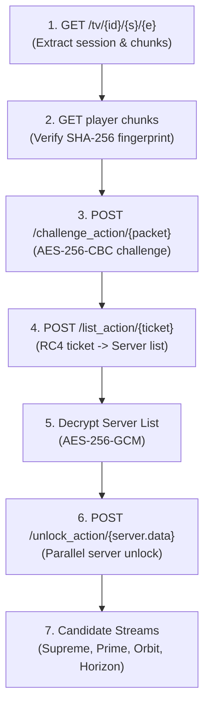
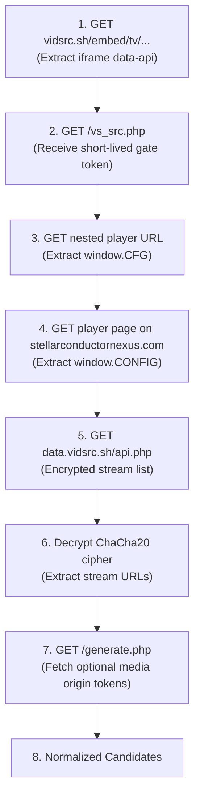

<!--
  PROVIDERS.md
  Stream TV Providers Service

  Created by ChrisRodStar.

  Summary:
  Detailed technical specifications, request chains, and reverse-engineered
  cryptographic algorithms for the four native provider adapters.
-->

<div align="center">

# Native Provider Specifications

**Complete technical reference for the VidCore, VidLink, VidSrc, and VidFast adapters.**

[Overview](#overview) &bull; [Adapter Common Rules](#adapter-common-rules) &bull; [VidCore](#vidcore-adapter) &bull; [VidLink](#vidlink-adapter) &bull; [VidSrc](#vidsrc-adapter) &bull; [VidFast](#vidfast-adapter) &bull; [Error Handling](#error-handling)

---

</div>

## Overview

The Stream TV Provider service uses four independent adapters to find streaming links for movies and television shows:

1. **VidCore** ([internal/provider/vidcore/](providers/internal/provider/vidcore))
2. **VidLink** ([internal/provider/vidlink/](providers/internal/provider/vidlink))
3. **VidSrc** ([internal/provider/vidsrc/](providers/internal/provider/vidsrc))
4. **VidFast** ([internal/provider/vidfast/](providers/internal/provider/vidfast))

All four adapters run natively in Go. None of them use WebAssembly runtimes or JavaScript interpreters. Instead, the cryptographic steps, token generators, and data transformations used by each streaming provider have been reverse-engineered and written directly in Go using standard cryptography libraries.

| Provider | Primary Format | Route Type | Encryption / Security Method | Upstream Origins |
| :--- | :--- | :--- | :--- | :--- |
| **VidCore** | HLS (`.m3u8`) | TMDB ID | AES-256-CBC, RC4, AES-256-GCM, custom permutations | `vidcore.io` |
| **VidLink** | Progressive MP4 | TMDB ID | SHA-256 WebAssembly fingerprint, static token derivation | `vidlink.pro` |
| **VidSrc** | HLS (`.m3u8`) | TMDB ID | Multi-stage redirect gate, ChaCha20 stream decryption | `vidsrc.sh`, `data.vidsrc.sh` |
| **VidFast** | HLS (`.m3u8`) | TMDB ID | Next.js bundle fingerprint, AES-256-GCM packet envelopes | `vidfast.vc` |

---

## Adapter Common Rules

All four adapters follow the same requirements:

1. **The Adapter Interface:** Every adapter implements `provider.Adapter` from [internal/provider/adapter.go](providers/internal/provider/adapter.go):
   ```go
   type Adapter interface {
       Name() string
       Resolve(ctx context.Context, title model.Title, preferences model.Preferences) (*model.AdapterResult, error)
   }
   ```
2. **No Internal Winner Selection:** An adapter must return all usable stream candidates it finds. It never picks a "winning" stream inside the adapter; the shared selection engine ranks all streams across all providers.
3. **Context and Header Scoping:** Required HTTP headers (such as `Referer` or `Origin`) are attached directly to each candidate record. Sensitive session tokens or internal credentials are never sent to external media CDNs.
4. **Independent Timeouts:** Each adapter execution is limited to 18 seconds. If an adapter hangs, it is stopped without affecting other providers.

---

## VidCore Adapter

The VidCore adapter communicates with `https://vidcore.io` to unlock multi-server HLS video streams.

### Route Mapping
- **Movies:** `https://vidcore.io/movie/{tmdb_id}`
- **TV Episodes:** `https://vidcore.io/tv/{tmdb_id}/{season}/{episode}`

### Request Pipeline



### Cryptographic Details

1. **Challenge Construction ([internal/provider/vidcore/crypto.go](providers/internal/provider/vidcore/crypto.go)):**
   - Generates 16 cryptographically random bytes and an 8-byte little-endian Unix millisecond timestamp.
   - Encrypts the session token using AES-256-CBC with the statically traced public key and IV.
   - Applies a dynamic SHA-256 XOR mask across 32-byte blocks.
   - Shuffles bytes using a 256-byte Fisher-Yates permutation and xorshift32 PRNG.
   - Substitutes characters through the player's custom base64url alphabet.

2. **Ticket Generation:**
   - Reverses the challenge response string and hex-encodes its UTF-8 characters.
   - Runs five sequential transformation stages using a position-modulo-10 byte rotation table and 32-byte static keys.
   - Interleaves the output with five sequential RC4 encryption passes.

3. **Server List and Unlock Decryption:**
   - Server list envelopes and source unlock payloads are encrypted with AES-256-GCM.
   - The adapter parses the 16-byte salt, 12-byte nonce, ciphertext, and 16-byte GCM authentication tag.
   - Decrypts the payload, strips an 8-byte plaintext prefix, and parses the clean JSON server objects.

4. **Master Playlist Promotion:**
   - For `Supreme` and `Prime` servers, stream URLs often point to a single low-resolution stream ending in `/sd/playlist.m3u8`.
   - The adapter automatically tests if a higher-quality sibling `/master.m3u8` exists at the same path. If verified, the candidate is promoted to the master playlist so all resolution variants (1080p, 720p, 480p) are unlocked.

---

## VidLink Adapter

The VidLink adapter communicates with `https://vidlink.pro` to retrieve progressive MP4 streams with multiple audio languages and subtitles.

### Route Mapping
- **Movies:** `https://vidlink.pro/api/b/movie/{token}?multiLang=1`
- **TV Episodes:** `https://vidlink.pro/api/b/tv/{token}/{season}/{episode}?multiLang=1`

### Request Pipeline

1. **Embed Request:** The adapter issues a GET request to the movie or TV embed page on `https://vidlink.pro` with standard browser headers and a dedicated cookie jar.
2. **WebAssembly Verification:** It fetches the player WebAssembly module from `/fu.wasm` (capped at 3 MB). It computes the SHA-256 hash and verifies it matches the known fingerprint:
   ```text
   27b65f7f7df985942df6197868896adbbdaf230fac7778089a8a0fa259a38f56
   ```
   If the hash changes, the adapter returns a `protocol_change` error so engineers know upstream updated their code.
3. **Native Token Generation ([internal/provider/vidlink/token.go](providers/internal/provider/vidlink/token.go)):**
   - The token algorithm computes a time-based authentication token using integer division on the current Unix timestamp and static player constants.
   - The result is formatted as a URL-safe base64 string without needing to execute the WebAssembly file.
4. **Data Retrieval:** The adapter requests the `/api/b/...` route with the headers:
   - `X-Playback-Environment: hls`
   - `Referer: https://vidlink.pro/`
5. **Candidate Extraction:** The response contains a JSON payload listing available qualities (1080p, 720p, 480p, 360p) and direct video URLs. Each quality option is normalized into a candidate stream record.

---

## VidSrc Adapter

The VidSrc adapter interacts with `https://vidsrc.sh` and its associated media networks.

### Route Mapping
- **Movies:** `https://vidsrc.sh/embed/movie/{tmdb_id}`
- **TV Episodes:** `https://vidsrc.sh/embed/tv/{tmdb_id}/{season}/{episode}`

### Multi-Stage Discovery Chain



### Cryptographic Details

VidSrc protects its stream URLs using an encrypted payload that is decrypted with ChaCha20:

1. **Key Extraction ([internal/provider/vidsrc/crypto.go](providers/internal/provider/vidsrc/crypto.go)):**
   - The player script downloads a rotating WebAssembly helper from `/wasm.php`.
   - The adapter reads the data section of the WebAssembly module without executing it.
   - It performs an XOR operation between the first 32 bytes of the data segment and 32 bytes at a declared mask address to recover the 256-bit ChaCha20 encryption key.
2. **Stream Decryption:**
   - The encrypted text is standard base64.
   - The first 12 bytes serve as the IETF ChaCha20 nonce.
   - The remaining bytes are decrypted using standard Go `golang.org/x/crypto/chacha20` to reveal newline-separated media URLs.
3. **Optional Origin Token Enrichment:**
   - Some media hosts require an extra authorization token obtained by calling `/generate.php`.
   - The adapter queries each distinct media origin concurrently with a strict 3-second total budget and a 1-second timeout per host. If a host token fails, the base stream URL is preserved for probing.

---

## VidFast Adapter

The VidFast adapter interacts with `https://vidfast.vc` to retrieve high-speed multi-server streams.

### Route Mapping
- **Movies:** `https://vidfast.vc/movie/{tmdb_id}`
- **TV Episodes:** `https://vidfast.vc/tv/{tmdb_id}/{season}/{episode}`

### Request Pipeline

1. **Route Inspection:** The adapter downloads the movie or TV page and inspects the Next.js `self.__next_f.push` streaming chunks to find the player component configuration.
2. **Shared Player Verification:** It downloads the shared player chunk `/_next/static/chunks/365-...js` (capped at 3 MB) and validates its SHA-256 hash:
   ```text
   97f52b92a9f7a1c6066f8b6ff3e2ad79f283f2e44f603de379912963f10809d0
   ```
3. **Challenge Packet Construction:** It generates a fresh 16-byte salt and timestamp, builds the native envelope, and sends a POST request to `/zirlaku/u/{bundle}/...`.
4. **Server Alternative Probing:** It transforms the challenge response and POSTs to `dBWKuO8aW6U/{token}` to receive an encrypted list of up to 16 server options.
5. **Parallel Unlocks:** Up to three server unlock workers run concurrently with a 3-second timeout per server.
6. **Decryption and Normalization:** Server responses are decrypted using AES-256-GCM. Stream URLs and referrer policies are converted into normalized candidate records.

---

## Error Handling

When an adapter encounters an issue, it reports structured errors categorized in [internal/model/result.go](providers/internal/model/result.go):

| Error Category | Meaning | System Behavior |
| :--- | :--- | :--- |
| `unavailable` | The requested movie or TV episode does not exist on this provider (HTTP 404 or empty stream list). | The coordinator ignores this provider and continues with the others. |
| `upstream_failure` | The provider's server returned an HTTP error (such as 500 or 502) or timed out. | Logged in the search result diagnostics; other providers continue. |
| `protocol_change` | An upstream site changed its HTML layout, JavaScript bundle hash, or encryption format. | Marked clearly in diagnostics so developers know the adapter needs an update. |
| `timeout` | The adapter exceeded its 18-second execution limit. | The coordinator cancels remaining operations for that adapter and proceeds with ranking. |
| `cancelled` | The client disconnected or cancelled the search. | All running network requests for that search are immediately aborted. |
