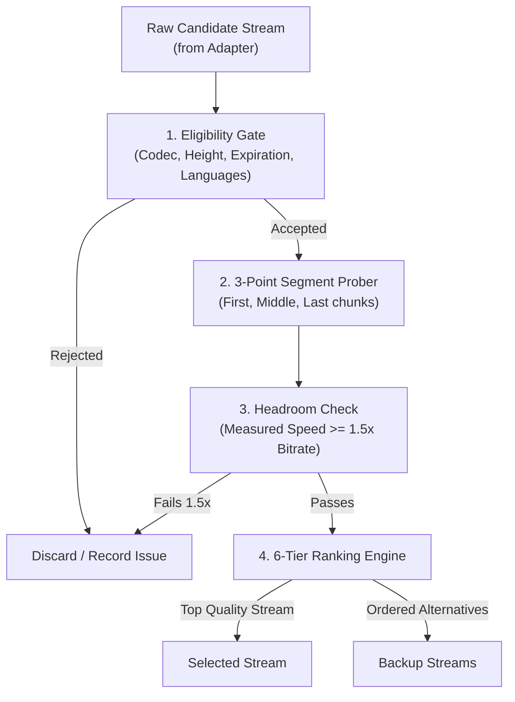

<!--
  SELECTION_AND_PROBING.md
  Stream TV Providers Service

  Created by ChrisRodStar.

  Summary:
  Media probing methodologies, 3-point segment sampling, throughput metrics,
  and the deterministic 6-tier stream selection and ranking policy.
-->

<div align="center">

# Stream Probing and Selection Policy

**How video streams are tested for quality and speed, and how the top stream and backups are chosen.**

[Overview](#overview) &bull; [Media Probing](#media-probing) &bull; [3-Point Segment Sampling](#3-point-segment-sampling) &bull; [Eligibility Checks](#eligibility-checks) &bull; [The 6-Tier Ranking Policy](#the-6-tier-ranking-policy) &bull; [Fast Startup and Adaptive Ladders](#fast-startup-and-adaptive-ladders)

---

</div>

## Overview

Finding a video stream URL from a third-party website is only the first step. Many stream links on the web are dead, severely rate-limited, missing audio tracks, or buffer constantly.

The Stream TV Provider service solves this by actively testing stream candidates before returning them to the user. The media prober contacts the media CDN directly through the local Mullvad VPN connection, inspects the video playlist, and downloads small samples of video data.

Once streams are measured, the selection engine filters out broken or low-bandwidth streams and sorts the remaining working candidates using a deterministic 6-tier ranking policy.



---

## Media Probing

The prober ([internal/probe/](providers/internal/probe)) supports both HLS adaptive streaming and progressive MP4 files.

### 1. HLS Playlist Inspection (`internal/probe/playlist.go`)
- **Master Playlist Parsing:** The prober reads the master playlist (`#EXTM3U`) and extracts all child stream renditions declared by `#EXT-X-STREAM-INF` tags.
- **Rendition Attributes:** For each rendition, the prober extracts:
  - Resolution width and height (such as `1920x1080` or `1280x720`).
  - Declared stream bitrate (such as `5,840,000` bits per second).
  - Video codecs (such as `avc1.640028` or `hev1.1.6.L93.B0`).
  - Audio and subtitle group references (`#EXT-X-MEDIA:TYPE=AUDIO` and `#EXT-X-MEDIA:TYPE=SUBTITLES`).
- **Encryption and Maps:** Preserves initialization segment references (`#EXT-X-MAP:URI="..."`) for fragmented MP4 (fMP4 / CMAF) and AES-128 encryption key locations (`#EXT-X-KEY:METHOD=AES-128`).
- **Media Chunklists:** The prober fetches the child playlist (`.m3u8`) to find the actual video segment URLs (`#EXTINF`).

### 2. Progressive MP4 Inspection (`internal/probe/media.go`)
- The prober sends an HTTP `HEAD` request followed by a single byte-range request (`Range: bytes=0-131071`).
- It verifies that the server returns HTTP `206 Partial Content` and reports the total content length.
- If a server ignores byte-range requests and attempts to send the entire multi-gigabyte file, the connection is closed immediately to protect system memory.

---

## 3-Point Segment Sampling

Streaming servers frequently cache the first few seconds of popular video files in their CDN edge servers. If a test only downloads the first video segment, the measured speed will look unrealistically fast while subsequent segments buffer and stall.

To measure real-world performance accurately, the prober takes three small samples along the length of the video:

```text
[=== First Segment ===] ------- [=== Middle Segment ===] ------- [=== Last Segment ===]
     (0% position)                    (50% position)                  (100% position)
  Tests startup latency             Tests steady-state speed        Checks for truncated files
```

1. **First Segment (0%):** Measures initial connection latency and time-to-first-byte (TTFB).
2. **Middle Segment (50%):** Measures sustained download speed on un-cached CDN storage.
3. **Last Segment (100%):** Verifies that the video file is complete and not truncated or corrupt.

### Measurement Rules
- **Sample Size:** Up to 128 KiB per sample position (bounded range requests).
- **Delivery Throughput:** The prober calculates the download speed of each segment and takes the **slowest measured speed** as the stream's throughput estimate. This guarantees a conservative, dependable speed metric.
- **Latency (TTFB):** The prober records the **longest time-to-first-byte delay** across the three samples.
- **Byte Budgets:** Each resolution search has a strict cumulative budget of **4 MB total probe traffic**. Once 4 MB of media data has been downloaded across all candidate tests, probing stops and selection uses the completed measurements.

---

## Eligibility Checks

Before any stream can be ranked, it must pass seven eligibility checks in [internal/selection/eligibility.go](providers/internal/selection/eligibility.go):

| Check | Requirement | Reason |
| :--- | :--- | :--- |
| **Title and Coordinates** | The stream must match the requested TMDB ID and TV season/episode. | Prevents showing the wrong episode. |
| **Expiration** | If the provider included an expiration timestamp, it must be in the future. | Discards expired URLs. |
| **Format Compatibility** | The client device must support the container (`hls` or `mp4`). | Prevents sending MP4 files to clients that only support HLS. |
| **Codec Compatibility** | Video and audio codecs must match the client's supported codec list. | Prevents sending HEVC (`hev1`) video to older devices that only support AVC (`avc1`). |
| **Resolution Ceiling** | The stream height must not exceed the client's maximum requested resolution. | Prevents sending 4K video to a 1080p phone screen. |
| **Language Match** | If the user requested an audio language (such as English), the stream must provide it. | Prevents playing dubbed or foreign audio when native audio was requested. |
| **1.5x Headroom Rule** | The measured download speed must be at least **1.5 times the stream's declared bitrate**. | Prevents buffering. For example, a 6 Mbps 1080p stream requires at least 9 Mbps measured delivery speed. |

If all samples fail or download speed cannot be measured, the stream is marked ineligible.

---

## The 6-Tier Ranking Policy

All eligible streams are sorted using a deterministic, 6-tier ranking policy implemented in [internal/selection/ranking.go](providers/internal/selection/ranking.go). The ranking engine treats all providers equally; no provider receives favoritism or hardcoded priority.

```text
Tier 1: Language Match (Audio first, then Subtitles)
   |
Tier 2: Delivery Headroom (Known bitrate with 1.5x headroom beats unknown bitrate)
   |
Tier 3: Resolution Quality (1080p > 720p > 480p > 360p)
   |
Tier 4: Within-Tier Score (Calculated bandwidth headroom + server reliability)
   |
Tier 5: Response Latency (Shortest time-to-first-byte delay)
   |
Tier 6: Deterministic Tiebreak (Alphabetical by Candidate Source ID)
```

### Tier 1: Language Match
Streams that match the user's preferred audio language come first. If multiple streams match the audio language, streams matching the preferred subtitle language come next. Streams with unconfirmed or missing language metadata are placed after confirmed matches.

### Tier 2: Delivery Headroom
Streams with a confirmed declared bitrate and proven 1.5x delivery speed take priority over streams with unknown bitrates. Streams with unknown bitrates are kept as secondary backup choices.

### Tier 3: Resolution Quality
Within the same language and headroom tier, **higher resolution always wins**:
- `1080p` beats `720p`
- `720p` beats `480p`
- `480p` beats `360p`

A 1080p stream will always be selected over a 720p stream, even if the 720p stream has higher excess download speed. Users want the highest visual quality their internet connection can sustain.

### Tier 4: Within-Tier Score
When two streams have the same resolution and language, the engine calculates a composite score based on:
1. **Excess Bandwidth Headroom:** Extra download speed beyond the required 1.5x threshold.
2. **Server Reliability Score:** Historical reliability ratio of that media server over the past 10 minutes (successful probes divided by total attempts).

### Tier 5: Response Latency
If two streams have the same score, the stream with the lowest Time-to-First-Byte (TTFB) is preferred so playback starts faster.

### Tier 6: Final Deterministic Tiebreak
If all measurements are identical, streams are sorted alphabetically by their unique candidate source ID. This guarantees that two identical requests will always produce the exact same stream order.

---

## Fast Startup and Adaptive Ladders

### Fast Startup Mode (`startup_height`)
When the public API issues a resolution request, it can include an optional `startup_height` parameter (such as `1080`).

When this flag is present, the search coordinator does not wait for all four providers or slower backup streams to finish. As soon as a single 1080p stream passes all three segment tests and satisfies the 1.5x headroom check, it is returned immediately with `pending: true`. The client starts video playback in under two seconds while remaining backup streams continue resolving quietly in the background.

### Adaptive Ladder Validation
When an HLS master playlist provides multiple resolutions, the prober verifies that the master playlist also includes a working lower rendition (such as 720p).

If internet speed drops temporarily on the user's phone or television, the video player can step down from 1080p to 720p without stopping playback. An unprobed rendition is never advertised in the adaptive ladder.
